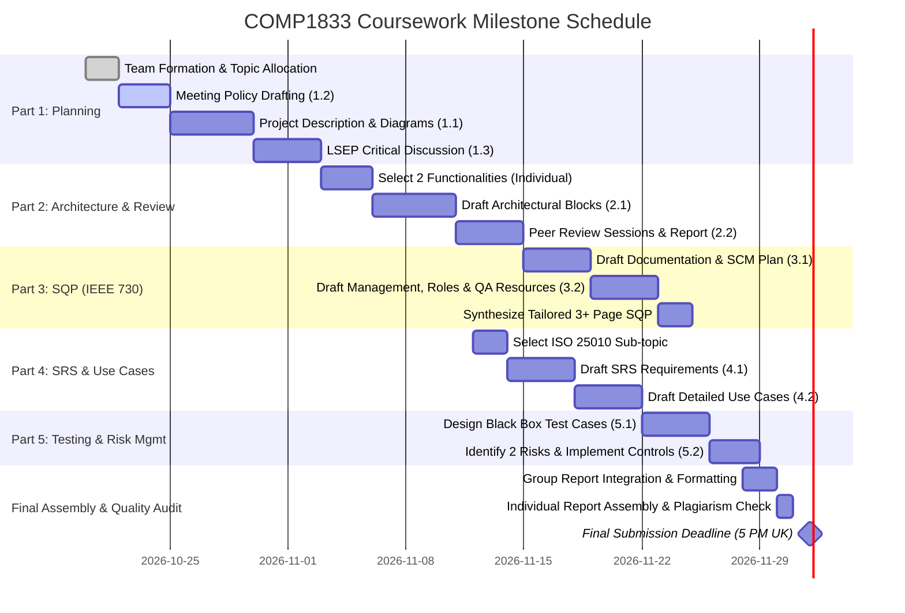

# Coursework Roadmap & Interactive Checklist

> [!TIP]
> Use this checklist in Obsidian by clicking the checkboxes as you complete each deliverable. Every milestone is cross-referenced to its corresponding detailed execution guide.

---

## 📅 High-Level Timeline & Milestones

---

## 📋 Comprehensive Deliverables Checklist

### Milestone 1: Part 1 — Project Planning (Group 20%)
*Execution Guide: [[02 - Part 1 - Project Planning (Group)/1.0 - Part 1 Step-by-Step Execution Guide|Part 1 Execution Guide]]*

- [ ] **1.1 Project Description Document (10 marks)**
  - [ ] Define the overarching healthcare operational transformation problem in Manchester.
  - [ ] Synthesize SATZ's mandate, client objectives (MHE), and end-user stakeholders.
  - [ ] Detail the solution: Real-time AI analytics, IoT sensor network, high-availability architecture.
  - [ ] Embed **Diagram 1**: Healthcare System Architecture (see [[07 - Diagrams & Visual Models/Diagram 1 - Healthcare System Architecture|Diagram 1]]).
  - [ ] Embed **Diagram 2**: Software & Operational Flow (see [[07 - Diagrams & Visual Models/Diagram 2 - Software & Operational Flow|Diagram 2]]).
  - [ ] Articulate architecture justification: eliminating legacy Single Point of Failure (SPOF) and budget risk.
- [ ] **1.2 Meeting Policy Document (5 marks)**
  - [ ] Define meeting cadence (weekly standups, sprint reviews, retrospective).
  - [ ] Specify platform (MS Teams / Discord / In-person) and documentation repository (Obsidian / GitHub).
  - [ ] Establish Quorum (e.g., minimum 75% attendance) and formal voting rules (consensus vs majority).
  - [ ] Codify non-attendance escalation policy and accountability measures.
  - [ ] Provide standard meeting agenda template and action-item tracking protocol.
- [ ] **1.3 Legal, Social, Ethical, and Professional (LSEP) Issues (5 marks)**
  - [ ] **Legal**: UK GDPR & Data Protection Act 2018 (handling special category health data, DPIA, right to erasure).
  - [ ] **Social**: Digital exclusion/divide in Manchester, accessibility (WCAG 2.1 AA), digital literacy training.
  - [ ] **Ethical**: AI bias in triage algorithms, transparency, patient consent, privacy vs sensor tracking.
  - [ ] **Professional**: British Computer Society (BCS) Code of Conduct adherence, engineering accountability.

---

### Milestone 2: Part 2 — SQA & Architectural Blocks (Individual & Peer Review 20%)
*Execution Guide: [[03 - Part 2 - SQA & Architectural Blocks (Individual)/2.0 - Part 2 Step-by-Step Execution Guide|Part 2 Execution Guide]]*

- [ ] **Team Coordination**: Verify all 4–5 members have chosen unique product functionalities (no overlap!).
- [ ] **2.1 Architectural Blocks (10 marks - Individual)**
  - [ ] Functionality 1 detailed description & scope.
  - [ ] Architectural block diagram for Functionality 1 (subsystems, microservices, APIs).
  - [ ] Concrete data structures specified (JSON schemas, relational tables, caching models).
  - [ ] Functionality 2 detailed description & scope.
  - [ ] Architectural block diagram for Functionality 2.
  - [ ] Concrete data structures specified for Functionality 2.
  - [ ] Quality Assurance justification: how this modular design enhances safety, maintainability, and testability.
- [ ] **2.2 Peer Review Report (10 marks - Peer Review)**
  - [ ] Conduct formal peer review of another member's architectural blocks using IEEE 1028 standard.
  - [ ] Log review metadata (Reviewer, Author, Date, Artifact Reviewed).
  - [ ] Complete defect logging table (Defect ID, Location, Severity, Description, Recommendation).
  - [ ] Provide constructive qualitative critique on data structure efficiency and coupling/cohesion.
  - [ ] Obtain sign-off confirmation from the author.

---

### Milestone 3: Part 3 — Software Quality Plan (IEEE 730-2014) (Group 20%)
*Execution Guide: [[04 - Part 3 - Software Quality Plan (IEEE 730-2014) (Group)/3.0 - Part 3 Step-by-Step Execution Guide|Part 3 Execution Guide]]*

- [ ] Verify total length is **no less than three (3) pages** of tailored, high-density academic content.
- [ ] **3.1 Documentation & Configuration Management SQP (10 marks)**
  - [ ] **User Documentation Plan**: Strategy for clinical staff manuals, patient self-service guides, API docs.
  - [ ] Documentation review, validation, and maintenance lifecycle.
  - [ ] **Software Configuration Management (SCM)**: Version control system (Git branching model / Trunk-based).
  - [ ] Baseline definition (SRS baseline, architectural baseline, release baseline).
  - [ ] Change Control Process (Change Request Form, Change Control Board / CCB approval flow).
  - [ ] CI/CD pipeline automation and build traceability.
- [ ] **3.2 Management-based SQP (10 marks)**
  - [ ] **Organizational Roles & Responsibilities**: SQA Manager, Lead Architect, Test Engineer, Clinical Liaison.
  - [ ] RACI Matrix (Responsible, Accountable, Consulted, Informed) for all quality activities.
  - [ ] **QA Estimated Resources**: QA staffing levels, hardware/cloud test environments, automated test tooling licenses.
  - [ ] Quantitative estimation model (e.g., COCOMO II quality estimation, Cost of Quality: Prevention, Appraisal, Failure).

---

### Milestone 4: Part 4 — SRS & Use Cases (ISO/IEC 25010) (Individual 20%)
*Execution Guide: [[05 - Part 4 - SRS & Use Cases (ISO IEC 25010) (Individual)/4.0 - Part 4 Step-by-Step Execution Guide|Part 4 Execution Guide]]*

- [ ] Verify each team member selects a distinct ISO/IEC 25010 sub-topic:
  - Member 1: *Performance Efficiency*
  - Member 2: *Security*
  - Member 3: *Portability*
  - Member 4: *Usability*
  - Member 5 (if applicable): *Maintainability*
- [ ] **4.1 Software Requirements Specification (10 marks - Individual)**
  - [ ] Introduction to selected ISO/IEC 25010 quality sub-characteristic.
  - [ ] Requirement 1: SMART format, unambiguous identifier, verification criteria, rationale.
  - [ ] Requirement 2: SMART format, unambiguous identifier, verification criteria, rationale.
  - [ ] Alignment with MHE operational context (e.g., latency under sensor load, RBAC data encryption).
- [ ] **4.2 Detailed Use Case Descriptions (10 marks - Individual)**
  - [ ] Use Case 1: Formal tabular specification (Cockburn format: Actors, Preconditions, Trigger, Main Flow, Alternate Flows, Postconditions).
  - [ ] Use Case 2: Formal tabular specification.
  - [ ] Traceability link demonstrating how Use Cases validate Requirement 1 and Requirement 2.

---

### Milestone 5: Part 5 — Black Box Testing & Risk Management (Individual 20%)
*Execution Guide: [[06 - Part 5 - Black Box Testing & Risk Management (Individual)/5.0 - Part 5 Step-by-Step Execution Guide|Part 5 Execution Guide]]*

- [ ] **5.1 Black Box Testing for Functionalities I and II (10 marks - Individual)**
  - [ ] Apply **Equivalence Partitioning (EP)**: Valid and invalid input partitions.
  - [ ] Apply **Boundary Value Analysis (BVA)**: Min, Min+, Nom, Max-, Max values.
  - [ ] Construct structured test case specifications (Test ID, Description, Preconditions, Input Data, Expected Result, Actual Result, Status Pass/Fail).
  - [ ] Execute test cases against Functionality 1 (minimum 3–4 test cases).
  - [ ] Execute test cases against Functionality 2 (minimum 3–4 test cases).
  - [ ] Document black box test summary and defect observation.
- [ ] **5.2 Product Risk Management & Control Implementation (10 marks - Individual)**
  - [ ] Identify **Risk 1** directly originating from Functionality 1 or test findings.
  - [ ] Identify **Risk 2** directly originating from Functionality 2 or test findings.
  - [ ] Conduct Risk Assessment using ISO 31000 matrix: Likelihood (1–5), Impact (1–5), Risk Priority Number (RPN).
  - [ ] Formulate concrete Risk Controls (Preventative, Detective, Corrective controls).
  - [ ] Define residual risk profile post-control implementation.

---

### Milestone 6: Final Integration, Referencing & Submission Audit
*Review Guide: [[09 - Complete Report Templates & Checklists/Final Submission Audit & Quality Checklist|Final Quality Audit]]*

- [ ] Check citation consistency: All claims cited using Cite Them Right Harvard / IEEE style.
- [ ] Verify IEEE 730-2014 and ISO/IEC 25010 standards are explicitly cited and analyzed.
- [ ] Verify UK legislation (Data Protection Act 2018, UK GDPR) and BCS Code of Conduct are integrated.
- [ ] Plagiarism & AI Check: Ensure all content is original or properly attributed in quotes.
- [ ] Visual Quality: Check that both Diagrams are crisp, high-resolution, and captioned.
- [ ] Submit before **2nd December 2026, 5:00 PM UK Time** via University Turnitin portal.
