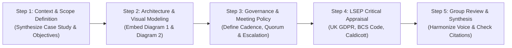

# Part 1: Project Planning — Step-by-Step Execution Guide

> [!IMPORTANT]
> **Part 1 Overview**: Group Work (20% of Coursework Mark).  
> **Core Objective**: Establish the project's strategic foundation, formal team governance, system architecture, and statutory/ethical boundaries.  
> **Breakdown**:
> - **1.1 Project Description Document + Diagram** (10 marks)
> - **1.2 Meeting Policy Document** (5 marks)
> - **1.3 Legal, Social, Ethical & Professional (LSEP) Issues** (5 marks)

---

## 🧭 Step-by-Step Execution Workflow

---

## 📋 Detailed Step-by-Step Instructions

### Step 1: Analyze Client Constraints & Define Project Scope (For Deliverable 1.1)
1. **Identify the Core Problem**:
   - Manchester Healthcare Entity (MHE) operates fragmented, non-AI systems.
   - Clinical staff lack daily operational visibility; facilities cannot maintain themselves.
   - Prior project failed due to budget overrun, contractor collapse, and zero documentation.
   - High risk of Single Point of Failure (SPOF).
2. **Formulate SATZ's Solution**:
   - Position "SATZ Manchester HealthAI" as a unified, real-time, event-driven platform.
   - Define concrete system boundaries: What is in-scope (triage dispatch, predictive maintenance, patient self-service, reward scheme, provider collaboration) and out-of-scope (direct surgical robotics, pharmaceutical manufacturing).
3. **Draft the Document**: Use [[02 - Part 1 - Project Planning (Group)/1.1 - Project Description Document Guide & Template|1.1 Project Description Guide & Template]].

### Step 2: Integrate Supporting System Diagrams (For Deliverable 1.1)
1. University specification requires: *"Please introduce a diagram to support your project description."*
2. Embed [[07 - Diagrams & Visual Models/Diagram 1 - Healthcare System Architecture|Diagram 1 (System Architecture)]] to illustrate the structural tiers, microservices, and geo-replicated backup.
3. Supplement with [[07 - Diagrams & Visual Models/Diagram 2 - Software & Operational Flow|Diagram 2 (Operational Flow)]] to showcase the dynamic event ingestion and AI dispatch loop.
4. Provide structured explanatory paragraphs beneath each diagram analyzing how they resolve MHE's legacy vulnerabilities.

### Step 3: Establish the Group Meeting Policy (For Deliverable 1.2)
1. Establish a formal contract governing how your 4–5 team members communicate, meet, make decisions, and resolve disputes.
2. Address key governance parameters:
   - Meeting Frequency (e.g., bi-weekly standups, sprint reviews).
   - Quorum (minimum attendance percentage, e.g., 75% or 80%).
   - Voting mechanisms (unanimous vs 2/3 majority for major architecture decisions).
   - Escalation and accountability protocol (dealing with non-contributing or late members).
3. Draft the formal policy using [[02 - Part 1 - Project Planning (Group)/1.2 - Meeting Policy Document Guide & Policy Template|1.2 Meeting Policy Guide & Template]].

### Step 4: Conduct a Rigorous LSEP Analysis (For Deliverable 1.3)
1. Avoid generic or superficial moralizing; anchor the discussion in UK statutory frameworks and professional bodies:
   - **Legal**: UK Data Protection Act 2018, UK GDPR (Special Category Health Data, Article 9; Data Protection Impact Assessment - DPIA; Right to Explanation).
   - **Social**: Healthcare accessibility in Greater Manchester, digital exclusion among elderly patients, digital divide, staff retraining.
   - **Ethical**: Algorithmic bias in AI triage models, autonomy vs automation, consent in continuous sensor tracking, gamification ethics.
   - **Professional**: British Computer Society (BCS) Code of Conduct (Public interest, professional competence, integrity).
2. Follow the detailed breakdown in [[02 - Part 1 - Project Planning (Group)/1.3 - Legal, Social, Ethical, and Professional (LSEP) Issues|1.3 LSEP Critical Analysis]].

### Step 5: Quality Assurance & Cross-Checking
- Ensure citations follow Cite Them Right Harvard / IEEE style.
- Check that all team members' names and student IDs appear on the title page.
- Review against [[01 - Coursework Specification & Case Study/High-Scoring Strategy (Rubric D1, D4, D5)|High-Scoring Strategy Rubric]].
