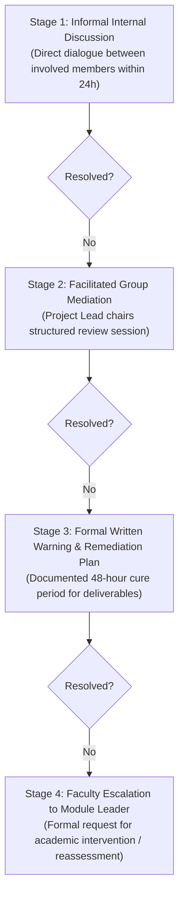

# 1.2 Meeting Policy Document Guide & Master Policy Template

> [!IMPORTANT]
> **Deliverable**: Part 1.2 Meeting Policy Document (5 Marks — Group).  
> **Requirement**: Establish a formal, enforceable governance policy to organize and regulate project planning meetings throughout the SATZ HealthAI lifecycle.  
> **Contextual Alignment**: In the case study, the previous contractor collapsed due to uncontrolled timeline slippage, lack of oversight, and communication breakdown. This meeting policy serves as an institutional quality control mechanism to guarantee accountability and transparency.

---

## 🏛️ Comprehensive Meeting Policy Document Template (SATZ Team Charter)

```
DOCUMENT CONTROL
Document Title: Project Planning Meeting Governance Policy
Project Name: SATZ AI-Powered Healthcare Management Platform for MHE
Module: COMP1833 Software Quality Management
Authors: [Team Member Names & IDs]
Version: 1.0 (Final Approved)
Effective Date: October 2026
```

---

### 1.0 Policy Purpose & Governance Objectives
The purpose of this Meeting Policy Document is to formalize operational communication, decision-making protocols, and quality oversight among team members tasked with delivering the SATZ Healthcare Management transformation for Manchester Healthcare Entity (MHE). 

Given historical project vulnerabilities—specifically the failure of MHE's previous contractor due to scope creep, budget overshoot, and poor coordination—this policy establishes rigorous standards for attendance, quorum, minute-taking, conflict resolution, and accountability.

### 2.0 Meeting Classification, Schedule & Channels

| Meeting Type | Frequency | Duration | Primary Objective | Mandatory Attendees |
| :--- | :--- | :--- | :--- | :--- |
| **Weekly SQA Standup** | Every Monday @ 10:00 AM | 30 mins | Review weekly deliverables, resolve blockers, track roadmap. | All Team Members (100%) |
| **Architectural Review** | Bi-weekly Thursday @ 2:00 PM | 60 mins | Peer review architectural blocks, data schemas, and API contracts. | Architecture Lead & Subsystem Authors |
| **SQP & IEEE 730 Alignment** | Bi-weekly Friday @ 3:00 PM | 45 mins | Audit documentation baselines, SCM logs, and QA resource burn rates. | SQA Lead, Project Lead, All Members |
| **Emergency / Ad-Hoc Meeting**| As needed (24h notice) | Max 45 mins| Address critical risks, severe defects, or team blockers. | Quorum Required |

- **Primary Virtual Medium**: Microsoft Teams (University of Greenwich Institutional Tenant).
- **Physical Medium**: Dreadnought Building / Stockwell Street Library Collaborative Study Rooms.
- **Official Documentation Hub**: Shared Git Repository / Obsidian Project Vault.

### 3.0 Quorum & Attendance Requirements
- **Quorum Definition**: A meeting is legally constituted to pass binding project decisions if a minimum **Quorum of 75%** of active group members (e.g., 3 out of 4, or 4 out of 5 members) is present.
- **Tardiness & Absence Protocol**:
  - Unplanned absences must be communicated via the official group channel at least **2 hours prior** to meeting commencement, stating valid grounds (medical, technical emergency).
  - Any member missing two consecutive meetings without prior formal justification will be subject to the *Escalation and Remediation Pathway* outlined in Section 7.0.

### 4.0 Standard Meeting Structure & Standing Agenda
Every project planning meeting must adhere to a standardized five-part agenda distributed at least **24 hours in advance**:
1. **Roll Call & Quorum Verification** (2 mins)
2. **Review of Preceding Action Items & Outstanding Tasks** (10 mins)
3. **Core Substantive Discussion** (e.g., Review of Diagram 1, IEEE 730 SQP Drafting, ISO 25010 Requirements) (25 mins)
4. **Risk & Blocker Identification** (10 mins)
5. **Action Item Allocation & Adjournment** (5 mins)

### 5.0 Decision-Making & Voting Protocol
- **Consensus Objective**: The team endeavors to resolve all architectural, quality, and organizational choices by unanimous consensus.
- **Voting Mechanism**: Where consensus cannot be achieved after reasonable debate (maximum 15 minutes), decisions will be resolved by formal vote:
  - *Standard Procedural Decisions*: Simple majority (>50% of attending quorum).
  - *Core Architectural & SQP Decisions*: Supermajority (two-thirds / ≥66% approval).
  - In the event of a tie, the designated **Project Lead (Member 1)** holds the casting vote.

### 6.0 Minute-Taking, Repository Auditing & Action Item Tracking
- **Rotation of Minute-Taker**: The responsibility of recording minutes rotates alphabetically among group members for each session.
- **Standard Minute Format**: Every meeting record must capture:
  - Date, time, venue/platform, attendees, and absentees.
  - Key discussions and design decisions taken (including dissenting views).
  - **Action Items Table**: Explicitly detailing *Action Description*, *Assigned Owner*, *Target Deadline*, and *Deliverable Reference*.
- **Publication Deadline**: Minutes must be committed to the project vault within **24 hours** post-meeting. Members have 24 hours to propose amendments, after which the minutes are deemed officially ratified.

### 7.0 Conflict Resolution & Non-Performance Escalation Pathway
To safeguard project integrity and prevent team dysfunction, the following four-stage escalation framework applies:



1. **Stage 1 (Informal Resolution)**: Disputing parties hold a bilateral conference to resolve discrepancies amicably.
2. **Stage 2 (Internal Team Mediation)**: The issue is placed on the agenda for a special meeting chaired by the Project Lead; neutral members mediate.
3. **Stage 3 (Formal Written Warning)**: If a member repeatedly fails to submit individual sections or attend meetings, the group issues a formal written notice with a 48-hour cure timeline.
4. **Stage 4 (Academic Escalation)**: If non-performance persists, the group formally notifies the **COMP1833 Module Leader**, submitting all verified meeting minutes, attendance logs, and version control commit records as auditable evidence.

### 8.0 Formal Ratification & Sign-off

| Member Role | Full Name | Student ID | Signature & Date |
| :--- | :--- | :--- | :--- |
| **Project Lead** | `[Student 1]` | `[ID 1]` | *Signed: [Date]* |
| **Architecture Lead** | `[Student 2]` | `[ID 2]` | *Signed: [Date]* |
| **SQA & SCM Lead** | `[Student 3]` | `[ID 3]` | *Signed: [Date]* |
| **Test Lead** | `[Student 4]` | `[ID 4]` | *Signed: [Date]* |
| **Risk & Compliance Lead** | `[Student 5]` | `[ID 5]` | *Signed: [Date]* |
