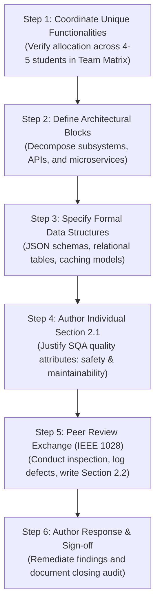

# Part 2: SQA & Architectural Blocks — Step-by-Step Execution Guide

> [!IMPORTANT]
> **Part 2 Overview**: Individual Work & Peer Review (20% of Coursework Mark).  
> **Key Rules**:
> 1. **Zero Functionality Duplication**: Each team member **MUST** select two distinct product functionalities that no other member in the group is covering.
> 2. **Peer Review Exchange**: Every team member must formally review another member's architectural blocks using a recognized software inspection standard (IEEE 1028).
> **Deliverables**:
> - **2.1 Architectural Blocks & Data Structures** (10 marks — Individual)
> - **2.2 Formal Peer Review Report** (10 marks — Peer Review)

---

## 🧭 Step-by-Step Execution Workflow

---

## 📋 Detailed Execution Instructions

### Step 1: Functionality Selection & Deconfliction (Mandatory Check)
- Review [[00 - Dashboard & Navigation/Group Coordination & Team Matrix|Group Coordination & Team Matrix]].
- Confirm your two assigned functionalities. For a group of 5, the 10 distinct functionalities are:
  - **Member 1**: F1 (AI Real-time Patient Triage) & F2 (IoT Facility Predictive Maintenance)
  - **Member 2**: F3 (Multi-Agency Clinical Collaboration) & F4 (Third-Party Provider Dispatch & Inventory)
  - **Member 3**: F5 (Patient Self-Service & Privacy Broker) & F6 (Gamified Wellness Reward Engine)
  - **Member 4**: F7 (IoT Sensor Telemetry Ingestion) & F8 (Automated Failover & State Backup)
  - **Member 5**: F9 (Continuous Service Feedback Loop) & F10 (Regulatory Audit Trail & Compliance)

### Step 2: Develop Architectural Blocks (Deliverable 2.1)
- For each of your two functionalities, create an **Architectural Block Diagram** illustrating:
  - Input/Ingestion endpoints (REST API, WebSockets, or MQTT).
  - Business logic/processing components (microservice modules, validation pipelines, AI inference calls).
  - Persistence & caching layers (PostgreSQL tables, TimescaleDB, Redis).
  - Output interfaces (Notifications, event bus publications, client responses).
- Explain how your architectural blocks ensure high cohesion and loose coupling.

### Step 3: Define Rigorous Data Structures (Deliverable 2.1)
- The coursework specification explicitly demands: *"illustrate the architectural blocks such as data structures of the project."*
- Merely listing field names is insufficient for Level 7. You must provide:
  - Strongly-typed data schemas (JSON Schema, TypeScript interfaces, or Relational DDL).
  - Type definitions, constraints (ranges, nullability, regex formats), primary/foreign keys.
  - SQA rationale: explain why specific data types (e.g., UUIDv4, ISO 8601 timestamps, signed integers) protect against buffer overflows, injection vulnerabilities, and race conditions.

### Step 4: Conduct Formal Peer Review (Deliverable 2.2)
- Exchange your Section 2.1 draft with your designated peer reviewer as mapped in the [[00 - Dashboard & Navigation/Group Coordination & Team Matrix|Peer Review Pairing Schedule]].
- Follow the **IEEE 1028-2008 Standard for Software Reviews and Audits** (specifically the *Software Inspection* method).
- Complete the formal [[03 - Part 2 - SQA & Architectural Blocks (Individual)/2.2 - Peer Review Methodology & Report Template|Peer Review Report Template]], documenting:
  - Review metadata (Author, Reviewer, Date, Version).
  - Defect severity breakdown (Major, Medium, Minor).
  - Detailed defect log with line references, root cause critique, and concrete corrective recommendations.
  - Qualitative evaluation of architectural modularity, cohesion, coupling, and data structure robustness.
  - Author sign-off confirming remediation of identified defects.
