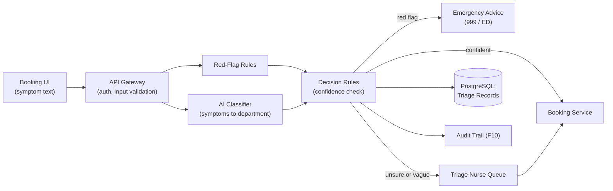
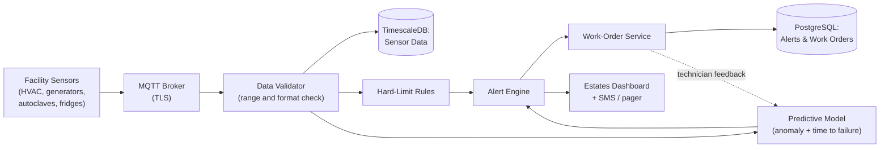
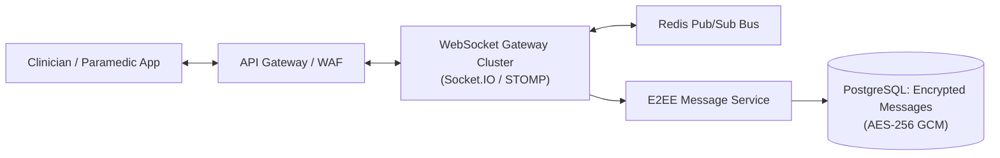
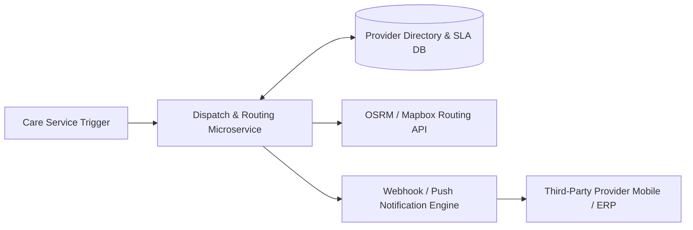

# 2.1 Architectural Blocks & Data Structures Guide

> [!IMPORTANT]
> **Deliverable**: Part 2.1 Architectural Blocks (10 Marks — Individual).  
> **Coursework Directive**: *"You should individually list two product functionalities and write a quality assurance document to illustrate the architectural blocks such as data structures of the project. The architectural blocks should be related to the product functionalities."*  
> **Requirement**: Each team member must select two **completely different** functionalities. Below is the complete catalog of 10 fully realized functionalities (2 per member for up to 5 students).

---

## 🗂️ Functionality Allocation Reference Map

| Member       | Functionality I                                                   | Functionality II                                               |
| :----------- | :---------------------------------------------------------------- | :------------------------------------------------------------- |
| **Minh**     | **F1**: Real-Time AI Emergency Patient Triage                     | **F2**: IoT Facility Predictive Maintenance & Alerting         |
| **Blue**     | **F3**: Multi-Party Clinical Collaboration & WebSockets Messaging | **F4**: Third-Party Service Provider Dispatch & Inventory Sync |
| **Vannapha** | **F5**: Patient Self-Service Portal & Granular Privacy Broker     | **F6**: Gamified Patient Wellness & Reward Scheme Engine       |
| **Ryan**     | **F9**: Patient Continuous Feedback & Service Improvement Loop    | **F10**: Regulatory Compliance & Immutable Audit Trail Logging |

---

## 🔬 MEMBER 1 (Minh): F1 & F2 Specifications

> [!NOTE]
> The platform serves the whole of Manchester, so no single-hospital sizing is assumed and every record carries a facility identifier. Thresholds marked *(design parameter)* are assumptions to be tuned during validation.

---

### Functionality 1 (F1): Real-Time AI Emergency Patient Triage

#### Operational Scope
When a patient books an appointment, they type their symptoms in free text. The AI reads the text and **recommends which department the patient should attend**. It is a routing aid, **not a diagnostic tool**.

- **The AI does**: recommend a department, spot red-flag symptoms and direct the patient to emergency care (999 / ED), and measure its own confidence.
- **The AI never**: names or ranks diseases, gives treatment advice, or blocks a booking.
- **Human in the loop**: if the symptoms are vague or the AI is not confident, the case is passed to a real triage nurse. Any system failure also falls back to the nurse (fail-safe).

> [!WARNING]
> Cite UK GDPR Art. 22 (a human review route is needed for automated decisions) and NHS DCB0129 / DCB0160 (clinical safety). The Manchester Triage System is a face-to-face method, so do not claim F1 is "MTS-compliant".

#### Architectural Block Diagram


| Block | Job |
| :--- | :--- |
| **API Gateway** | Authenticates the patient and rejects empty, oversized or malformed text |
| **Red-Flag Rules** | Fixed rules for time-critical symptoms (e.g. chest pain, stroke signs). They run **separately from the AI**, so an AI error cannot hide an emergency |
| **AI Classifier** | Turns the text into a department recommendation with a confidence score |
| **Decision Rules** | The only block that chooses the outcome (table below) |
| **Triage Nurse Queue** | Worklist where a nurse confirms, changes or phones the patient |
| **Booking Service / Storage** | Books the slot, stores the record and sends an event to the audit trail |

#### Decision Rules *(design parameters)*
| Outcome (`decisionPath`) | When | What happens |
| :--- | :--- | :--- |
| `EMERGENCY_ADVICE` | Any red flag detected | Patient sees 999 / ED guidance and a nurse is alerted |
| `AUTO_ROUTED` | Confidence ≥ 0.80 | Slot offered in the recommended department. The nurse can still override |
| `NURSE_REVIEW` | Confidence 0.50 – 0.79 | Provisional department shown, nurse confirms within 15 min |
| `HUMAN_ESCALATION` | Confidence < 0.50, vague text (fewer than 2 symptom terms), AI error or timeout (> 2 s), or patient asks for a person | No AI result shown, nurse calls the patient back within 30 min |

#### Formal Data Structure (JSON Schema)
```json
{
  "$schema": "https://json-schema.org/draft/2020-12/schema",
  "title": "TriageDecisionRecord",
  "type": "object",
  "required": ["triageId", "patientId", "symptomText", "decisionPath", "modelVersion", "createdAt"],
  "properties": {
    "triageId": { "type": "string", "format": "uuid" },
    "patientId": { "type": "string", "pattern": "^NHS-[0-9]{10}$" },
    "facilityId": { "type": "string", "format": "uuid" },
    "symptomText": { "type": "string", "minLength": 3, "maxLength": 1000 },
    "redFlags": { "type": "array", "maxItems": 10, "items": { "type": "string", "maxLength": 50 } },
    "recommendedDepartment": {
      "type": ["string", "null"],
      "enum": ["EMERGENCY_DEPARTMENT", "URGENT_TREATMENT_CENTRE", "GENERAL_MEDICINE", "CARDIOLOGY", "RESPIRATORY", "ORTHOPAEDICS", "MENTAL_HEALTH", "GP_PRIMARY_CARE", null]
    },
    "confidence": { "type": "number", "minimum": 0.0, "maximum": 1.0 },
    "decisionPath": { "type": "string", "enum": ["EMERGENCY_ADVICE", "AUTO_ROUTED", "NURSE_REVIEW", "HUMAN_ESCALATION"] },
    "escalationReason": {
      "type": ["string", "null"],
      "enum": ["LOW_CONFIDENCE", "VAGUE_INPUT", "MODEL_UNAVAILABLE", "PATIENT_REQUESTED_HUMAN", null]
    },
    "reviewedBy": { "type": "string", "format": "uuid" },
    "finalDepartment": { "type": "string", "maxLength": 32 },
    "modelVersion": { "type": "string", "pattern": "^[0-9]+\\.[0-9]+\\.[0-9]+$" },
    "createdAt": { "type": "string", "format": "date-time" }
  },
  "allOf": [
    {
      "if": { "properties": { "decisionPath": { "const": "AUTO_ROUTED" } } },
      "then": { "required": ["recommendedDepartment", "confidence"], "properties": { "confidence": { "minimum": 0.80 } } }
    },
    {
      "if": { "properties": { "decisionPath": { "const": "HUMAN_ESCALATION" } } },
      "then": { "required": ["escalationReason"] }
    }
  ]
}
```

#### F1 SQA Rationale
- **Safety**: red-flag rules sit outside the AI, and every failure falls back to a nurse.
- **Data integrity**: the schema makes unsafe records impossible, e.g. `AUTO_ROUTED` with confidence 0.79 is rejected.
- **Security / privacy**: symptom text is the most sensitive field, so it is encrypted at rest and kept out of logs. Length limits and parameterised queries block oversized or injected input.
- **Traceability & maintainability**: each record stores `modelVersion` and the reviewer, and thresholds can be changed in the Decision Rules without touching the AI.

**Boundary value seeds for Part 5**: text length 2 / 3 / 1000 / 1001; confidence 0.49 / 0.50 / 0.79 / 0.80; AI response 1.9 s vs 2.1 s.

---

### Functionality 2 (F2): IoT Facility Predictive Maintenance & Alerting

#### Operational Scope
F2 monitors the hospital's **overall facilities** (HVAC, backup generators / UPS, medical gas, autoclaves, cold-chain fridges, lifts) through IoT sensors. A predictive model spots abnormal behaviour and estimates **time to failure**, so that a maintenance work order is raised *before* the equipment breaks. This answers the case-study finding that *"most of the facilities are not capable of maintaining themselves."*

**Two layers of protection**: (1) fixed **hard-limit rules** always alert on unsafe readings, and (2) the **predictive model** catches slow degradation the limits would miss. If the model is offline, layer 1 keeps working.

#### Architectural Block Diagram


| Block | Job |
| :--- | :--- |
| **MQTT Broker** | Receives sensor data over TLS. Each device has its own certificate |
| **Data Validator** | Rejects out-of-range, malformed or duplicate readings before they reach the model |
| **Hard-Limit Rules** | Fixed safety limits per asset type (e.g. fridge above 8 °C). No AI involved. Also flags a sensor that goes silent |
| **Predictive Model** | Learns normal behaviour per asset type, outputs an anomaly score (0–1) and an estimated hours-to-failure |
| **Alert Engine** | Combines rule and model results into a severity, and suppresses duplicate alerts |
| **Work-Order Service** | Creates and tracks the maintenance job. The technician's result (real fault or false alarm) is fed back to improve the model |

#### Alert Severity *(design parameters)*
| Severity | Trigger | Work-order priority | Who is told |
| :--- | :--- | :--- | :--- |
| `WARNING` | Anomaly score 0.60 – 0.79, or failure expected in under 14 days | P3: within 5 working days | Dashboard |
| `CRITICAL` | Anomaly score ≥ 0.80, or failure expected in under 72 h | P2: within 24 h | Dashboard + SMS / pager |
| `EMERGENCY` | Hard limit breached on a critical asset | P1: response within 1 h | Dashboard + SMS / pager + duty manager |

**Scale**: sensors across all MHE facilities feed one pipeline, so ingestion and analytics must scale horizontally. Sizing figures are confirmed during performance testing.

#### Formal Data Structures
**(a) Telemetry message (TypeScript interface)**
```typescript
interface FacilityTelemetryMessage {
  telemetryId: string;          // UUIDv4, used to drop duplicates
  assetId: string;              // pattern ^AST-[A-Z0-9]{6}$, e.g. "AST-GEN001"
  assetType: "GENERATOR_UPS" | "MEDICAL_GAS" | "HVAC" | "AUTOCLAVE" | "COLD_CHAIN" | "LIFT";
  location: { facilityId: string; wardOrZoneId: string; roomIdentifier?: string };  // facilityId: UUID of the site
  readings: {
    temperatureCelsius: number;   // -40.0 to 200.0
    vibrationRmsMmS: number;      //   0.0 to 100.0
    pressureBar: number;          //   0.0 to 30.0
    powerWatts: number;           //   0 to 50000
  };
  sampledAt: string;            // ISO 8601 UTC, rejected if more than 5 min in the future
}
```

**(b) Alert and work order (relational DDL)**
```sql
CREATE TABLE maintenance_alerts (
    alert_id             UUID PRIMARY KEY DEFAULT gen_random_uuid(),
    facility_id          UUID NOT NULL,
    asset_id             VARCHAR(10) NOT NULL CHECK (asset_id ~ '^AST-[A-Z0-9]{6}$'),
    detected_by          VARCHAR(12) NOT NULL CHECK (detected_by IN ('HARD_LIMIT', 'ML_MODEL', 'SENSOR_SILENT')),
    anomaly_score        NUMERIC(3,2) CHECK (anomaly_score BETWEEN 0 AND 1),
    est_hours_to_failure INTEGER CHECK (est_hours_to_failure BETWEEN 0 AND 8760),
    severity             VARCHAR(10) NOT NULL CHECK (severity IN ('WARNING', 'CRITICAL', 'EMERGENCY')),
    recommended_action   VARCHAR(24) NOT NULL CHECK (recommended_action IN
                         ('INSPECT_BEARINGS', 'THERMAL_FLUSH', 'CALIBRATE_PRESSURE', 'CHECK_SENSOR', 'IMMEDIATE_SHUTDOWN')),
    work_order_status    VARCHAR(12) NOT NULL DEFAULT 'OPEN'
                         CHECK (work_order_status IN ('OPEN', 'IN_PROGRESS', 'COMPLETED')),
    technician_finding   VARCHAR(16) CHECK (technician_finding IN ('REAL_FAULT', 'FALSE_ALARM')),
    sla_deadline         TIMESTAMPTZ NOT NULL,
    created_at           TIMESTAMPTZ NOT NULL DEFAULT CURRENT_TIMESTAMP
);
```

#### F2 SQA Rationale
- **Data integrity**: the validator stops faulty readings from triggering false alarms or corrupting the model's training data. The database `CHECK` constraints repeat the same limits.
- **Safety / reliability**: hard-limit rules work even if the model is down, and a silent sensor is treated as a fault, not as "all good".
- **Security**: per-device certificates stop rogue devices from injecting data.
- **Maintainability & traceability**: the model can be replaced without touching ingestion, and technician feedback measures its accuracy. Every alert is stored with its cause and deadline.

**Boundary value seeds for Part 5**: temperature -40.1 / -40.0 / 200.0 / 200.1; anomaly score 0.59 / 0.60 / 0.79 / 0.80; hours to failure 71 / 72; timestamp 5 min vs 5 min 1 s in the future; duplicate `telemetryId`.

---

## 🔬 MEMBER 2: F3 & F4 Specifications

### Functionality 3 (F3): Multi-Party Clinical Collaboration & Messaging
- **Operational Scope**: Enables real-time, encrypted, multi-agency communication between hospital clinicians, triage nurses, and external service providers (e.g., paramedics and diagnostic staff).

#### Architectural Block Diagram


#### Formal Data Structure (Relational Schema / DDL)
```sql
CREATE TABLE clinical_collaboration_messages (
    message_id UUID PRIMARY KEY DEFAULT gen_random_uuid(),
    session_id UUID NOT NULL REFERENCES clinical_care_sessions(session_id),
    sender_id UUID NOT NULL REFERENCES system_users(user_id),
    sender_role VARCHAR(32) CHECK (sender_role IN ('TRIAGE_NURSE', 'CONSULTANT', 'PARAMEDIC', 'LAB_SCIENTIST')),
    recipient_group VARCHAR(64) NOT NULL, -- E.g., "TRAUMA_RESPONSE_TEAM_ALPHA"
    encrypted_payload TEXT NOT NULL, -- AES-256 GCM encrypted ciphertext
    initialization_vector VARCHAR(32) NOT NULL,
    key_derivation_id VARCHAR(64) NOT NULL,
    message_urgency VARCHAR(16) DEFAULT 'ROUTINE' CHECK (message_urgency IN ('ROUTINE', 'URGENT', 'CRITICAL_STAT')),
    acknowledged_by UUID[] DEFAULT ARRAY[]::UUID[],
    dispatched_at TIMESTAMPTZ NOT NULL DEFAULT CURRENT_TIMESTAMP,
    expires_at TIMESTAMPTZ NOT NULL -- Caldicott retention auto-purge
);
```

---

### Functionality 4 (F4): Third-Party Service Provider Dispatch & Inventory Sync
- **Operational Scope**: Dispatches work orders to external service providers (private ambulance operators, medical device maintenance contractors), synchronizing inventory levels and equipment reservations in real time.

#### Architectural Block Diagram


#### Formal Data Structure (JSON Schema)
```json
{
  "$schema": "https://json-schema.org/draft/2020-12/schema",
  "title": "ProviderDispatchOrder",
  "type": "object",
  "required": ["dispatchOrderId", "providerId", "serviceType", "pickupCoordinates", "slaDeadline", "orderStatus"],
  "properties": {
    "dispatchOrderId": { "type": "string", "format": "uuid" },
    "providerId": { "type": "string", "format": "uuid" },
    "serviceType": { "type": "string", "enum": ["AMBULANCE_TRANSFER", "BIOHAZARD_TRANSPORT", "EQUIPMENT_REPAIR", "DIAGNOSTIC_MOBILE_XRAY"] },
    "slaDeadline": { "type": "string", "format": "date-time" },
    "allocatedAssetId": { "type": "string", "maxLength": 32 },
    "orderStatus": { "type": "string", "enum": ["PENDING_ACCEPTANCE", "EN_ROUTE", "ON_SCENE", "COMPLETED", "SLA_BREACHED"] },
    "pickupCoordinates": {
      "type": "object",
      "required": ["latitude", "longitude"],
      "properties": {
        "latitude": { "type": "number", "minimum": 53.0, "maximum": 54.0 },
        "longitude": { "type": "number", "minimum": -2.6, "maximum": -2.0 }
      }
    }
  }
}
```

---

## 🔬 MEMBER 3: F5 & F6 Specifications

### Functionality 5 (F5): Patient Self-Service Portal & Privacy Broker
- **Operational Scope**: Provides patients with an accessible portal for appointment scheduling, viewing health insights, and managing granular UK GDPR consent settings in real-time, replacing MHE's outdated web forms.

#### Architectural Block Diagram & Data Structure
```typescript
interface PatientPrivacyConsentRecord {
  consentId: string; // UUIDv4
  patientId: string; // NHS number hash
  consentVersion: string; // E.g., "v3.2_2026"
  telemetryConsent: {
    allowWearableBiometricSync: boolean;
    allowFacilityOccupancyTracking: boolean;
    allowDeidentifiedResearchAggregation: boolean;
  };
  communicationChannels: {
    smsNotificationsEnabled: boolean;
    emailAlertsEnabled: boolean;
    inAppPushEnabled: boolean;
  };
  consentTimestamp: string; // ISO 8601
  auditIPAddress: string;
  digitalSignatureHash: string; // SHA-256 hash for legal non-repudiation
}
```

---

### Functionality 6 (F6): Gamified Patient Wellness & Reward Scheme Engine
- **Operational Scope**: Incentivizes digital engagement and preventive healthcare behaviors by awarding "Manchester Health Points" for completing self-service check-ins, routine screenings, and health surveys.

#### Architectural Block Diagram & Data Structure
```json
{
  "$schema": "https://json-schema.org/draft/2020-12/schema",
  "title": "RewardTransactionRecord",
  "type": "object",
  "required": ["transactionId", "patientId", "actionType", "pointsCredited", "timestamp", "currentBalance"],
  "properties": {
    "transactionId": { "type": "string", "format": "uuid" },
    "patientId": { "type": "string", "pattern": "^NHS-[0-9]{10}$" },
    "actionType": {
      "type": "string",
      "enum": ["SELF_SERVICE_TRIAGE_CHECKIN", "PREVENTATIVE_SURVEY_COMPLETED", "VACCINATION_APPOINTMENT_ATTENDED", "DEVICE_MAINTENANCE_FEEDBACK"]
    },
    "pointsCredited": { "type": "integer", "minimum": 5, "maximum": 500 },
    "currentBalance": { "type": "integer", "minimum": 0 },
    "redeemableVoucherCode": { "type": ["string", "null"] },
    "timestamp": { "type": "string", "format": "date-time" }
  }
}
```

---

## 🔬 MEMBER 4: F7 & F8 Specifications

### Functionality 7 (F7): IoT Medical Sensor Telemetry Ingestion Engine
- Ingests high-velocity MQTT telemetry from thousands of medical sensors, validates payloads at line-rate, and routes valid packets to TimescaleDB.

### Functionality 8 (F8): Automated High-Availability Failover & State Backup
- Continuously monitors primary cloud cluster health; triggers automated DNS redirect and hot-standby database promotion when latency > 5000ms or 3 consecutive heartbeats fail.

---

## 🔬 MEMBER 5: F9 & F10 Specifications

### Functionality 9 (F9): Patient Continuous Feedback & Service Improvement Loop
- Collects structured patient/staff feedback post-intervention, conducts automated sentiment analysis, and computes Service Quality (SERVQUAL) indices.

### Functionality 10 (F10): Regulatory Compliance & Immutable Audit Trail Logging
- Generates cryptographically sealed, append-only audit entries for all system actions, fulfilling UK GDPR Article 30 and CQC inspection requirements.

---

## 🛡️ Software Quality Assurance (SQA) Justification (To Include in Report)

When writing your individual section, explain how your architectural blocks enhance:
1. **Fault Isolation (Safety)**: Crashing the Reward Engine (F6) cannot impact Emergency Triage (F1).
2. **Data Integrity**: JSON schema validation at the gateway rejects malformed, out-of-range sensor data before it contaminates clinical decision models.
3. **Traceability & Maintainability**: Independent microservice repositories allow decoupled CI/CD deployments without hospital downtime.
4. **Human Oversight of AI (F1)**: The triage AI only routes, never diagnoses. Red-flag rules run outside the ML model, and low-confidence or vague input is escalated to a triage nurse, which is also the UK GDPR Art. 22 safeguard.
5. **Defence in Depth for Predictions (F2)**: Hard-limit rules and a sensor watchdog protect the facility even when the predictive model is offline or wrong.
