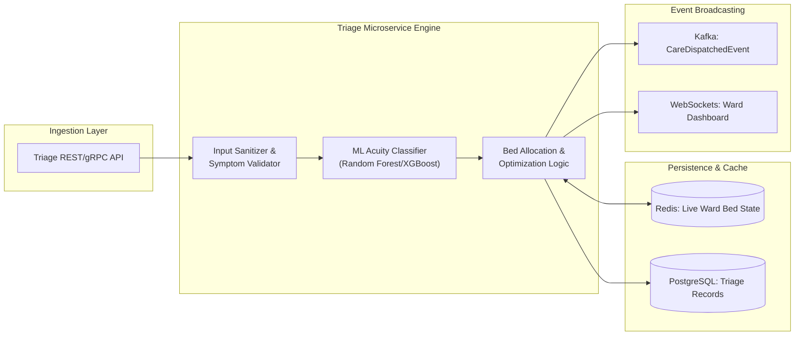
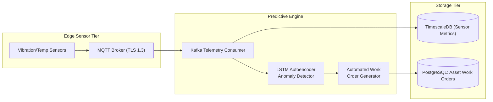
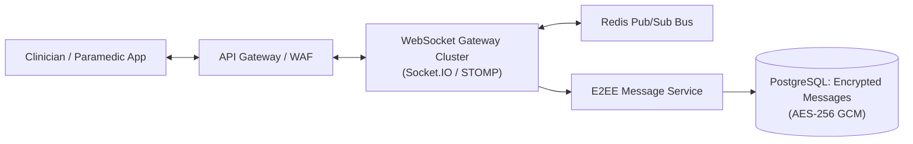
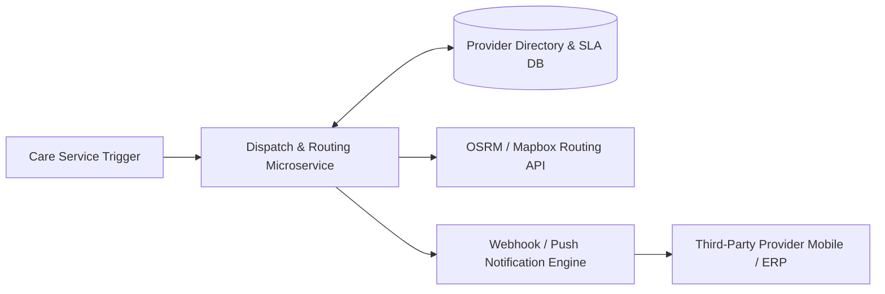

# 2.1 Architectural Blocks & Data Structures Guide

> [!IMPORTANT]
> **Deliverable**: Part 2.1 Architectural Blocks (10 Marks — Individual).  
> **Coursework Directive**: *"You should individually list two product functionalities and write a quality assurance document to illustrate the architectural blocks such as data structures of the project. The architectural blocks should be related to the product functionalities."*  
> **Requirement**: Each team member must select two **completely different** functionalities. Below is the complete catalog of 10 fully realized functionalities (2 per member for up to 5 students).

---

## 🗂️ Functionality Allocation Reference Map

| Member | Functionality I | Functionality II |
| :--- | :--- | :--- |
| **Member 1** | **F1**: Real-Time AI Emergency Patient Triage & Bed Dispatch | **F2**: IoT Facility Predictive Maintenance & Alerting |
| **Member 2** | **F3**: Multi-Party Clinical Collaboration & WebSockets Messaging | **F4**: Third-Party Service Provider Dispatch & Inventory Sync |
| **Member 3** | **F5**: Patient Self-Service Portal & Granular Privacy Broker | **F6**: Gamified Patient Wellness & Reward Scheme Engine |
| **Member 4** | **F7**: IoT Medical Sensor Telemetry Ingestion Engine | **F8**: Automated High-Availability Failover & State Backup |
| **Member 5** | **F9**: Patient Continuous Feedback & Service Improvement Loop | **F10**: Regulatory Compliance & Immutable Audit Trail Logging |

---

## 🔬 MEMBER 1: F1 & F2 Specifications

### Functionality 1 (F1): Real-Time AI Emergency Patient Triage & Bed Dispatch
- **Operational Scope**: Ingests real-time emergency care requests, computes dynamic acuity scores (Manchester Triage System compliant), matches patients to available ward beds, and broadcasts dispatch notifications.

#### Architectural Block Diagram


#### Formal Data Structure (JSON Schema)
```json
{
  "$schema": "https://json-schema.org/draft/2020-12/schema",
  "title": "TriageAssessmentRecord",
  "type": "object",
  "required": ["triageId", "patientId", "acuityLevel", "allocatedWardBed", "timestamp", "triageScore"],
  "properties": {
    "triageId": { "type": "string", "format": "uuid" },
    "patientId": { "type": "string", "pattern": "^NHS-[0-9]{10}$" },
    "symptoms": {
      "type": "array",
      "items": { "type": "string", "maxLength": 100 },
      "minItems": 1
    },
    "vitals": {
      "type": "object",
      "required": ["heartRate", "systolicBP", "spO2", "temperatureCelsius"],
      "properties": {
        "heartRate": { "type": "integer", "minimum": 20, "maximum": 260 },
        "systolicBP": { "type": "integer", "minimum": 40, "maximum": 300 },
        "spO2": { "type": "number", "minimum": 50.0, "maximum": 100.0 },
        "temperatureCelsius": { "type": "number", "minimum": 30.0, "maximum": 45.0 }
      }
    },
    "acuityLevel": { "type": "string", "enum": ["RED_IMMEDIATE", "ORANGE_VERY_URGENT", "YELLOW_URGENT", "GREEN_STANDARD", "BLUE_NON_URGENT"] },
    "triageScore": { "type": "number", "minimum": 0.0, "maximum": 1.0 },
    "allocatedWardBed": {
      "type": "object",
      "required": ["facilityId", "wardId", "bedNumber"],
      "properties": {
        "facilityId": { "type": "string", "format": "uuid" },
        "wardId": { "type": "string", "maxLength": 16 },
        "bedNumber": { "type": "integer", "minimum": 1, "maximum": 500 }
      }
    },
    "timestamp": { "type": "string", "format": "date-time" }
  }
}
```

---

### Functionality 2 (F2): IoT Facility Predictive Maintenance & Alerting
- **Operational Scope**: Ingests environmental and medical device sensor readings (autoclaves, backup generators, HVAC), computes Remaining Useful Life (RUL), and triggers automated maintenance work orders before physical breakdown occurs.

#### Architectural Block Diagram


#### Formal Data Structure (TypeScript Interface / Schema)
```typescript
interface FacilityAssetTelemetry {
  telemetryId: string; // UUIDv4
  assetId: string; // E.g., "MHE-MRI-04" or "MHE-AUTOCLAVE-12"
  facilityLocation: {
    hospitalCode: "MRI" | "NMGH" | "WYTH"; // Manchester Royal Infirmary, North Manchester, Wythenshawe
    buildingWing: string;
    floorLevel: number;
    roomIdentifier: string;
  };
  sensorReadings: {
    vibrationRMS_mm_s: number; // 0.0 to 100.0
    operatingTemperatureCelsius: number; // -20.0 to 180.0
    pressureBar: number; // 0.0 to 30.0
    powerConsumptionWatts: number; // 0 to 50000
  };
  predictiveAnalytics: {
    anomalyConfidenceScore: number; // 0.00 to 1.00
    estimatedFailureWindowHours: number; // E.g., 48 hours to critical breakdown
    recommendedIntervention: "INSPECT_BEARINGS" | "THERMAL_FLUSH" | "CALIBRATE_PRESSURE" | "IMMEDIATE_SHUTDOWN";
  };
  telemetryTimestamp: string; // ISO 8601
}
```

---

## 🔬 MEMBER 2: F3 & F4 Specifications

### Functionality 3 (F3): Multi-Party Clinical Collaboration & Messaging
- **Operational Scope**: Enables real-time, encrypted, multi-agency communication between hospital clinicians, triage nurses, and external service providers (e.g., paramedics and diagnostic staff).

#### Architectural Block Diagram


#### Formal Data Structure (Relational Schema / DDL)
```sql
CREATE TABLE clinical_collaboration_messages (
    message_id UUID PRIMARY KEY DEFAULT gen_random_uuid(),
    session_id UUID NOT NULL REFERENCES clinical_care_sessions(session_id),
    sender_id UUID NOT NULL REFERENCES system_users(user_id),
    sender_role VARCHAR(32) CHECK (sender_role IN ('TRIAGE_NURSE', 'CONSULTANT', 'PARAMEDIC', 'LAB_SCIENTIST')),
    recipient_group VARCHAR(64) NOT NULL, -- E.g., "TRAUMA_RESPONSE_TEAM_ALPHA"
    encrypted_payload TEXT NOT NULL, -- AES-256 GCM encrypted ciphertext
    initialization_vector VARCHAR(32) NOT NULL,
    key_derivation_id VARCHAR(64) NOT NULL,
    message_urgency VARCHAR(16) DEFAULT 'ROUTINE' CHECK (message_urgency IN ('ROUTINE', 'URGENT', 'CRITICAL_STAT')),
    acknowledged_by UUID[] DEFAULT ARRAY[]::UUID[],
    dispatched_at TIMESTAMPTZ NOT NULL DEFAULT CURRENT_TIMESTAMP,
    expires_at TIMESTAMPTZ NOT NULL -- Caldicott retention auto-purge
);
```

---

### Functionality 4 (F4): Third-Party Service Provider Dispatch & Inventory Sync
- **Operational Scope**: Dispatches work orders to external service providers (private ambulance operators, medical device maintenance contractors), synchronizing inventory levels and equipment reservations in real time.

#### Architectural Block Diagram


#### Formal Data Structure (JSON Schema)
```json
{
  "$schema": "https://json-schema.org/draft/2020-12/schema",
  "title": "ProviderDispatchOrder",
  "type": "object",
  "required": ["dispatchOrderId", "providerId", "serviceType", "pickupCoordinates", "slaDeadline", "orderStatus"],
  "properties": {
    "dispatchOrderId": { "type": "string", "format": "uuid" },
    "providerId": { "type": "string", "format": "uuid" },
    "serviceType": { "type": "string", "enum": ["AMBULANCE_TRANSFER", "BIOHAZARD_TRANSPORT", "EQUIPMENT_REPAIR", "DIAGNOSTIC_MOBILE_XRAY"] },
    "slaDeadline": { "type": "string", "format": "date-time" },
    "allocatedAssetId": { "type": "string", "maxLength": 32 },
    "orderStatus": { "type": "string", "enum": ["PENDING_ACCEPTANCE", "EN_ROUTE", "ON_SCENE", "COMPLETED", "SLA_BREACHED"] },
    "pickupCoordinates": {
      "type": "object",
      "required": ["latitude", "longitude"],
      "properties": {
        "latitude": { "type": "number", "minimum": 53.0, "maximum": 54.0 },
        "longitude": { "type": "number", "minimum": -2.6, "maximum": -2.0 }
      }
    }
  }
}
```

---

## 🔬 MEMBER 3: F5 & F6 Specifications

### Functionality 5 (F5): Patient Self-Service Portal & Privacy Broker
- **Operational Scope**: Provides patients with an accessible portal for appointment scheduling, viewing health insights, and managing granular UK GDPR consent settings in real-time, replacing MHE's outdated web forms.

#### Architectural Block Diagram & Data Structure
```typescript
interface PatientPrivacyConsentRecord {
  consentId: string; // UUIDv4
  patientId: string; // NHS number hash
  consentVersion: string; // E.g., "v3.2_2026"
  telemetryConsent: {
    allowWearableBiometricSync: boolean;
    allowFacilityOccupancyTracking: boolean;
    allowDeidentifiedResearchAggregation: boolean;
  };
  communicationChannels: {
    smsNotificationsEnabled: boolean;
    emailAlertsEnabled: boolean;
    inAppPushEnabled: boolean;
  };
  consentTimestamp: string; // ISO 8601
  auditIPAddress: string;
  digitalSignatureHash: string; // SHA-256 hash for legal non-repudiation
}
```

---

### Functionality 6 (F6): Gamified Patient Wellness & Reward Scheme Engine
- **Operational Scope**: Incentivizes digital engagement and preventive healthcare behaviors by awarding "Manchester Health Points" for completing self-service check-ins, routine screenings, and health surveys.

#### Architectural Block Diagram & Data Structure
```json
{
  "$schema": "https://json-schema.org/draft/2020-12/schema",
  "title": "RewardTransactionRecord",
  "type": "object",
  "required": ["transactionId", "patientId", "actionType", "pointsCredited", "timestamp", "currentBalance"],
  "properties": {
    "transactionId": { "type": "string", "format": "uuid" },
    "patientId": { "type": "string", "pattern": "^NHS-[0-9]{10}$" },
    "actionType": {
      "type": "string",
      "enum": ["SELF_SERVICE_TRIAGE_CHECKIN", "PREVENTATIVE_SURVEY_COMPLETED", "VACCINATION_APPOINTMENT_ATTENDED", "DEVICE_MAINTENANCE_FEEDBACK"]
    },
    "pointsCredited": { "type": "integer", "minimum": 5, "maximum": 500 },
    "currentBalance": { "type": "integer", "minimum": 0 },
    "redeemableVoucherCode": { "type": ["string", "null"] },
    "timestamp": { "type": "string", "format": "date-time" }
  }
}
```

---

## 🔬 MEMBER 4: F7 & F8 Specifications

### Functionality 7 (F7): IoT Medical Sensor Telemetry Ingestion Engine
- Ingests high-velocity MQTT telemetry from thousands of medical sensors, validates payloads at line-rate, and routes valid packets to TimescaleDB.

### Functionality 8 (F8): Automated High-Availability Failover & State Backup
- Continuously monitors primary cloud cluster health; triggers automated DNS redirect and hot-standby database promotion when latency > 5000ms or 3 consecutive heartbeats fail.

---

## 🔬 MEMBER 5: F9 & F10 Specifications

### Functionality 9 (F9): Patient Continuous Feedback & Service Improvement Loop
- Collects structured patient/staff feedback post-intervention, conducts automated sentiment analysis, and computes Service Quality (SERVQUAL) indices.

### Functionality 10 (F10): Regulatory Compliance & Immutable Audit Trail Logging
- Generates cryptographically sealed, append-only audit entries for all system actions, fulfilling UK GDPR Article 30 and CQC inspection requirements.

---

## 🛡️ Software Quality Assurance (SQA) Justification (To Include in Report)

When writing your individual section, explain how your architectural blocks enhance:
1. **Fault Isolation (Safety)**: Crashing the Reward Engine (F6) cannot impact Emergency Triage (F1).
2. **Data Integrity**: JSON schema validation at the gateway rejects malformed, out-of-range sensor data before it contaminates clinical decision models.
3. **Traceability & Maintainability**: Independent microservice repositories allow decoupled CI/CD deployments without hospital downtime.
