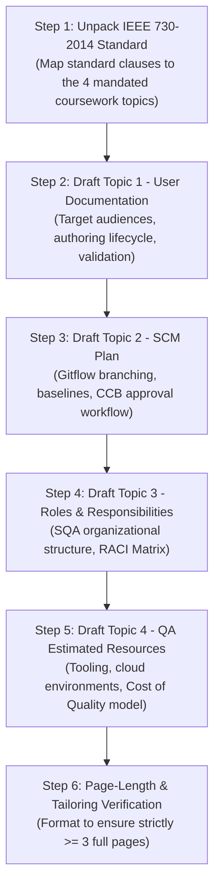

# Part 3: Software Quality Plan (IEEE 730-2014) — Step-by-Step Execution Guide

> [!IMPORTANT]
> **Part 3 Overview**: Group Work (20% of Coursework Mark).  
> **Coursework Directive**: *"Using the IEEE 730-2014 standard as a guide, you should write a no less than three-page tailored document on the following topics based on your project: Documentation (user documentation and configuration management) and Management (roles and responsibilities, and quality assurance estimated resources)."*  
> **Mandatory Criteria**:
> 1. **Length**: Must be **no less than three (3) pages** in length (~1,500 – 2,000 words).
> 2. **Standard Alignment**: Must strictly follow the structure and terminology of **IEEE Standard 730-2014 for Software Quality Assurance Processes**.
> 3. **Contextual Tailoring**: Explicitly tailored to MHE's healthcare environment and designed to prevent the catastrophic failure experienced with the previous collapsed contractor.

---

## 🧭 Step-by-Step Execution Workflow



---

## 📖 Deconstructing IEEE 730-2014 for the Coursework

The IEEE 730-2014 standard specifies the requirements for initiating, planning, controlling, and executing the Software Quality Assurance (SQA) processes of a software project. While the full standard covers 16 distinct sections, the coursework requires a **tailored document** focusing on two major sections:

```
IEEE 730-2014 TAILORED STRUCTURE FOR COMP1833
├── PART 3.1: DOCUMENTATION-BASED SQP (10 Marks)
│   ├── Clause 5.3.1: User Documentation Plan
│   │   ├── Target Audiences (Patients, Clinicians, Facility Engineers, Providers)
│   │   ├── Documentation Types (Clinical SOPs, In-App Guidance, API Specs)
│   │   └── Review, Verification & Maintenance Cycle
│   └── Clause 5.3.2: Software Configuration Management (SCM)
│       ├── Version Control Strategy (Gitflow / Trunk-based)
│       ├── Baseline Management (Functional, Allocated, Product Baselines)
│       ├── Change Control Board (CCB) & Formal Change Request Workflow
│       └── Release Management & Automated CI/CD Traceability
│
└── PART 3.2: MANAGEMENT-BASED SQP (10 Marks)
    ├── Clause 5.2.1: SQA Organization, Roles & Responsibilities
    │   ├── Independence of the SQA Organization
    │   ├── Key Role Profiles (SQA Manager, SCM Engineer, Test Lead, Clinical Liaison)
    │   └── RACI Governance Matrix
    └── Clause 5.2.2: Quality Assurance Estimated Resources
        ├── Staffing & Effort Estimation (COCOMO II / Function Point Analysis)
        ├── Tooling & Infrastructure Environment (Test Clouds, Emulators, CI runners)
        └── Cost of Quality (CoQ) Model (Prevention, Appraisal, Internal/External Failure)
```

---

## ⚠️ Critical SQA Trap: Avoiding Generic Boilerplate

To score in the **80–100% Exceptional** band:
- **Do not simply copy generic definitions** of what Git is or what user documentation is.
- **Tailor everything to MHE**:
  - Address the case study finding: *"The contractor folded, and MHE was left with an unusable prototype software product with no documentation."*
  - Frame your SCM and documentation plan as an auditable insurance policy that guarantees MHE will never again be trapped with an unmaintainable system.
  - Address the finding: *"Limited training is provided to staff. Many patients in the UK struggle to utilise the healthcare services provided due to limited knowledge."* Explain how your user documentation and in-app guidance directly solve this training deficit.
