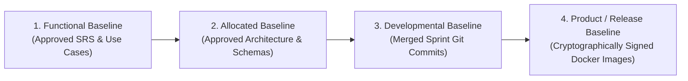
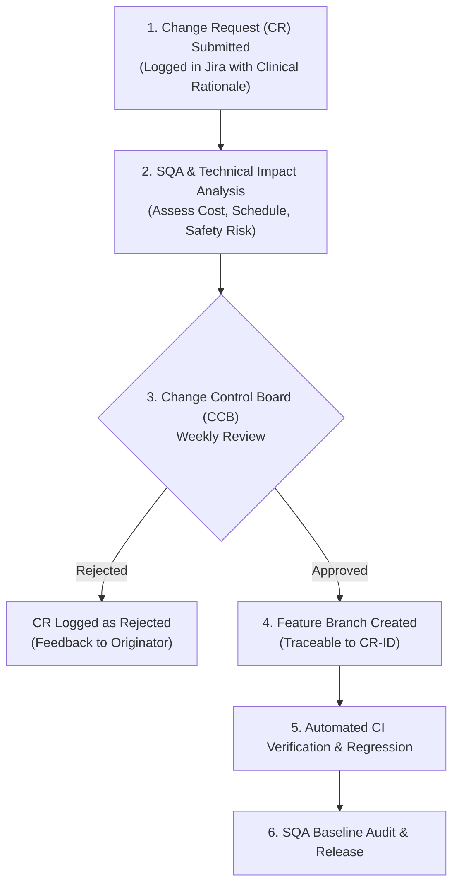

# 3.1 Tailored SQP: Documentation & Configuration Management (SCM)

> [!IMPORTANT]
> **Coursework Deliverable**: Part 3.1 Documentation-based SQP (10 Marks — Group).  
> **Standard Guidance**: **IEEE Std 730-2014** (Clause 5.3 SQA Activities — Documentation & Configuration Management).  
> **Contextual Mandate**: Directly mitigates MHE's historical collapse caused by the previous contractor abandoning an *"unusable prototype with no documentation"*.

---

## 📄 IEEE 730-2014 TAILORED SQP — SECTION 1: DOCUMENTATION & SCM

### 1.0 User Documentation Management Plan (IEEE 730 Clause 5.3.1)

#### 1.1 Purpose & Mitigation of Operational Training Deficit
The case study established that *"limited training is provided to staff"* and *"many patients in the UK struggle to utilise the healthcare services provided due to limited knowledge of the product."* 

To eliminate this vulnerability, SATZ establishes a comprehensive, multi-tiered **User Documentation Lifecycle** treating documentation as a first-class engineering artifact governed by identical rigor to executable source code.

#### 1.2 Target Stakeholder Documentation Taxonomy

| Target Audience | Documentation Deliverable | Medium / Format | SQA Quality Acceptance Criteria |
| :--- | :--- | :--- | :--- |
| **Patients** (Public) | Patient Self-Service Guide & Privacy Rights Handbook | In-App Interactive Onboarding, HTML5 Web Portal & Large-Print PDF | Readability: **Flesch-Kincaid Grade Level ≤ 6**; WCAG 2.1 Level AA compliance; multi-lingual (English, Urdu, Polish, Arabic). |
| **Clinical Ward Staff** | Clinical Triage & Bed Management Standard Operating Procedure (SOP) | Context-Sensitive UI Tooltips, Quick-Reference Clinical Cards & Digital SOP | Validated by Manchester Clinical Safety Officer (CSO) under DCB0129 / DCB0160 clinical safety standards. |
| **Facility Engineers** | IoT Sensor Calibration & Predictive Maintenance Field Manual | Tablet-Optimized Digital Manual with Interactive 3D Schematics | Complete step-by-step diagnostic workflows; verified by certified biomedical engineering technician. |
| **Third-Party Providers** | Logistics Dispatch & Real-Time API Integration Specifications | OpenAPI 3.1 Interactive Docs (Swagger Hub) & Secure Webhook Guide | 100% endpoint test coverage; interactive sandbox with simulated patient transport payloads. |
| **System Administrators** | Disaster Recovery, Backup & Failover Runbook | Version-Controlled Markdown Repository (`/docs/runbooks`) | Zero ambiguous steps; verified via scheduled bi-annual failover simulation drills. |

#### 1.3 Documentation Authoring, Review & Continuous Maintenance Workflow
- **Docs-as-Code Methodology**: All documentation source files are authored in Markdown/Asciidoc and stored in the primary Git monorepo alongside application code (`/docs`).
- **Automated Validation Pipeline**: Every pull request triggering a documentation update runs automated linters:
  - *Vale linter* (enforcing Plain English Campaign style guides and forbidden medical jargon).
  - *Markdownlint* (syntax and dead hyperlink validation).
  - *Automated Readability Score Analyzer*.
- **Clinical Sign-Off**: Any modification to clinical triage instructions mandates dual sign-off from the SQA Lead and the NHS Clinical Safety Officer prior to publication.

---

### 2.0 Software Configuration Management (SCM) Plan (IEEE 730 Clause 5.3.2)

#### 2.1 SCM Objectives & The "Zero-Orphan" Mandate
To ensure MHE is never again left with an undocumented, unmaintainable prototype, the SATZ SCM process guarantees **complete end-to-end provenance, auditable version control, and reproducible build automation** from requirements down to deployed binary artifacts.

#### 2.2 Configuration Identification & Baseline Strategy
A Configuration Baseline represents an immutable, formally approved state of a software configuration item (SCI):



1. **Functional Baseline**: Formally established upon client approval of the SRS (Part 4) and Project Description (Part 1). Locked against unapproved feature drift.
2. **Allocated Baseline**: Formally established upon verification of Architectural Blocks (Part 2) and API contracts.
3. **Developmental Baseline**: Iteratively updated at the close of each 2-week development sprint following successful regression testing.
4. **Product / Release Baseline**: Formally tagged release versions (e.g., `v1.4.0-GA`) packaged as immutable container images with a cryptographically signed **Software Bill of Materials (SBOM)** using SPDX/CycloneDX formats.

#### 2.3 Version Control Architecture & Branching Model
SATZ implements a strict **Gitflow-Derived Branching Model** hosted on a SOC2-compliant enterprise Git repository with branch protection rules:

```
main (Protected)     ───────────●──────────────────────────● (Production Tag v1.0.0)
                                ▲                          ▲
release/* (Staging)  ───────────┼──────────●───────────────┘ (Hotfix merge)
                                │          ▲
develop (Integration)────────●──┴───────●──┘
                             ▲          ▲
feature/* (Topics)   ────────┘          └─── [Feature Branch]
```

- **Branch Protection Rules**:
  - Direct pushing to `main` and `develop` is cryptographically blocked.
  - Merging into `develop` mandates:
    1. Passing all automated CI unit, integration, and security tests.
    2. Minimum of **two (2) approved peer code reviews**.
    3. Mandatory cryptographic GPG commit signing by verified SATZ engineers.

#### 2.4 Change Control Process & Change Control Board (CCB)
Uncontrolled scope creep was a primary catalyst for the previous contractor's failure. All modifications post-baseline must follow the formal Change Control Process:



- **Composition of the Change Control Board (CCB)**:
  - *Permanent Members*: SATZ SQA Manager (Chair), Lead Systems Architect, MHE Clinical Safety Lead, and MHE Commercial Project Director.
  - *Meeting Frequency*: Weekly standing session; emergency reviews convened within 4 hours for critical clinical safety patches.

#### 2.5 Automated CI/CD Pipeline & Audit Traceability
- **Traceability Matrix**: Every commit message must reference an approved requirement ID (e.g., `git commit -m "feat(triage): enforce systolic BP bounds [SRS-PERF-01] [CR-104]"`).
- **Automated Quality Gates**:
  - *Static Application Security Testing (SAST)*: SonarQube quality gate enforcing zero critical vulnerabilities and >80% test coverage.
  - *Software Composition Analysis (SCA)*: Snyk scanner to block open-source dependencies with known CVE vulnerabilities.
  - *Container Signing*: Cosign/Sigstore signing of production container images, preventing unauthorized binaries from running in MHE's cloud environment.
