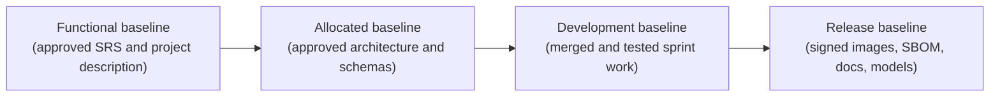

# 3.1 Tailored SQP: Documentation & Configuration Management (SCM)

> [!IMPORTANT]
> **Coursework Deliverable**: Part 3.1 Documentation-based SQP (10 Marks — Group).  
> **Standard Guidance**: **IEEE Std 730-2014**, tailored to the documentation and configuration management content areas of a software quality assurance plan. Management (roles, responsibilities and resources) is covered in [[04 - Part 3 - Software Quality Plan (IEEE 730-2014) (Group)/3.2 - SQP Section 2 - Management, Roles & QA Resources|3.2]].  
> **Contextual Mandate**: Directly mitigates MHE's earlier project failure, which left it with an *"unusable prototype software product with no documentation"*.  
> **Length**: about 1,450 words of body text plus tables (roughly 3 pages), so 3.1 alone exceeds 2 pages and, with 3.2, the plan exceeds the three-page minimum.

---

## 1. Purpose and Scope

This section defines how SATZ plans, produces, reviews and controls the **documentation** and **configuration items** of the SATZ Manchester HealthAI Platform for the Manchester Healthcare Entity (MHE). It covers the eight platform functions: patient self-service and privacy, wellness rewards, AI patient triage, IoT predictive maintenance, clinical collaboration, provider dispatch and inventory, service feedback, and audit trail. The platform is intended for use across the whole of Manchester, covering all MHE-managed facilities, so documentation and configuration control must scale to many sites, wards and user groups while keeping one consistent baseline.

The plan responds to three case-study findings:
1. The previous contractor left no documentation, so the prototype could not be maintained.
2. Staff received limited training and patients struggled to use services through limited knowledge of the product.
3. MHE depended on one software product, so documentation, code and backups must be recoverable if SATZ or a platform site fails.

**Principle**: documentation is a controlled deliverable. A release baseline cannot be approved unless its documentation is current, reviewed and stored where MHE can reach it (IEEE, 2014).

## 2. Documentation Inventory

| Document | Purpose | Owner (see 3.2) | Control |
| :--- | :--- | :--- | :--- |
| Software Quality Plan (3.1 and 3.2) | Defines SQA activities | SQA Manager | Approved at functional baseline |
| Project description, SRS and use cases | Agreed scope and requirements | Lead Systems Architect | Functional baseline, client approval |
| Architectural blocks and data structures (e.g. F1 `TriageDecisionRecord`, F2 telemetry and alert records) | Design of each function | Lead Systems Architect | Allocated baseline, IEEE 1028 inspection |
| Model documentation (intended use, limits, thresholds, validation results) for AI triage and predictive maintenance | Safe and transparent use of AI | Development team, signed off by Clinical Safety Officer | Reviewed on every model release |
| Test plans, black-box test reports, risk register and hazard log | Verification, validation and safety evidence | Senior Test Engineer; Clinical Safety Officer | Linked to requirement IDs |
| Runbooks (failover, backup and restore, release) | Operating the platform | DevSecOps & SCM Engineer | Tested in drills before release |
| User documentation | See Section 3 | Per audience | Release gate |
| Configuration records (baseline register, change log, release notes, SBOM) | Provenance and audit | DevSecOps & SCM Engineer | Updated per change |

## 3. User Documentation Plan

### 3.1 Audiences and Deliverables
Content is tailored to the functions each audience uses. Targets marked *(target)* are design values to be confirmed through usability testing.

| Audience | Tailored content | Format | Acceptance criteria |
| :--- | :--- | :--- | :--- |
| **Patients and carers** | Booking and symptom entry guide: the AI suggests a department and **never diagnoses**, when to call 999, how to ask for a person; privacy and consent guide; how rewards work | In-app onboarding, accessible web pages, easy-read and large-print PDF | WCAG 2.1 AA (W3C, 2018); Flesch-Kincaid grade ≤ 6 *(target)*; tested with representative patients. English at launch, further languages prioritised from local demographic data |
| **Triage nurses and ward staff** | Procedure for the triage review queue (confirm, override, call back), emergency-advice alerts, clinical messaging | Quick-reference cards, in-app tooltips, e-learning | Clinical Safety Officer sign-off against DCB0129 / DCB0160; ≥ 90% of trained staff complete scenarios correctly *(target)* |
| **Estates and facility staff** | Alert and work-order guide for predictive maintenance: severity levels, acknowledging alerts, recording real fault or false alarm, sensor calibration | Tablet-friendly digital manual | Procedures verified on the hardware test rig by a qualified technician |
| **Third-party providers** | Dispatch and inventory API specification, onboarding guide | OpenAPI 3.1 interactive documentation with sandbox | Every endpoint documented and covered by contract tests |
| **System administrators** | Failover, backup/restore and release runbooks | Version-controlled Markdown | Each runbook executed successfully in a drill; repeated twice yearly |
| **Regulators and auditors** | Audit trail guide, privacy impact summary, model documentation, clinical safety case summary | HTML/PDF pack generated per release | Complete for every release and traceable to requirement IDs |

### 3.2 Authoring, Review and Maintenance
- **Docs-as-code**: documents are written in Markdown, stored with the source in each service repository, with cross-cutting documents in a shared documentation repository, and changed only by pull request.
- **Automated checks** on every pull request: Markdown lint, broken-link check, house-style linter and readability score.
- **Documentation definition of done**: a change to behaviour, user interface, AI thresholds or alert rules is not merged until the affected documents are updated and the change request ID is referenced.
- **Review**: peer review of every change; formal inspection (IEEE, 2008) of key documents; Clinical Safety Officer sign-off for any clinical instruction.

### 3.3 Training Linkage
Role-based training is built directly from the user documentation: onboarding for each ward before go-live, a named super-user per ward, and a short refresher with the release notes for each release. Patient and staff feedback (service feedback function) and help-desk queries feed documentation updates each sprint. This addresses the training and knowledge gaps in the case study, and design standards for user information such as ISO/IEC/IEEE 26514 guide the content structure.

## 4. Software Configuration Management (SCM)

### 4.1 Configuration Identification
| Configuration item (CI) category | Examples | Identification |
| :--- | :--- | :--- |
| Requirements and design | Project description, SRS, architectural blocks | `SATZ-DOC-nnn` plus version |
| Source code and infrastructure | Microservices, front ends, infrastructure scripts | Repository plus semantic version tag `vMAJOR.MINOR.PATCH` |
| Data structures | Database migrations, JSON schemas | Versioned migration and schema files |
| **AI artefacts** | Trained models, training-data snapshots (checksummed), feature code, evaluation reports | Model registry version, recorded as `modelVersion` in each triage record |
| **Safety configuration** | F1 confidence thresholds and red-flag rule list; escalation timings; F2 hard limits and alert severities | Versioned configuration files |
| **Site configuration** | Department lists, escalation contacts and asset registers for each facility | Versioned configuration files per site |
| Test assets | Test cases, scripts, results | Linked to requirement IDs |
| Release artefacts | Signed container images, SBOM, release notes | Release tag plus image digest |

AI artefacts and safety configuration are controlled because they directly affect patient and facility safety. They cannot be edited in production, and any change follows Section 4.3 with Clinical Safety Officer approval.

### 4.2 Baselines

Each baseline is approved by the Change Control Board and recorded in the baseline register. The release baseline is only approved when code, documentation, model versions and safety configuration are all at matching, audited versions.

### 4.3 Change Control
| Step | Activity |
| :--- | :--- |
| 1. Raise | A change request (CR) is logged in the issue tracker, linked to a requirement or risk ID |
| 2. Assess | Impact analysis covers safety, privacy, performance, testing, documentation, cost and schedule |
| 3. Decide | The Change Control Board (CCB) meets weekly. Safety defects get an emergency review within 4 hours |
| 4. Implement | Work is done on a branch named after the CR ID |
| 5. Verify | CI tests, regression tests and the documentation check must pass |
| 6. Release | The baseline register and release notes are updated |

**CCB membership** (consistent with the roles in 3.2): SQA Manager (chair), Lead Systems Architect, MHE Clinical Safety Officer, Compliance and Privacy Officer, DevSecOps & SCM Engineer, and an MHE operational representative *[group to name]*. Changes to AI models or safety configuration require the Clinical Safety Officer's approval.

### 4.4 Status Accounting and Configuration Audits
- **Status accounting**: the baseline register, CR log, release notes, SBOM and model registry history give a traceable record of what is in each release and why. The SCM Engineer reports status monthly to the SQA Manager.
- **Audits**: before each release baseline, a *functional* audit checks that the build meets approved requirements using test evidence, and a *physical* audit checks that the released image matches its tag, SBOM and documentation (IEEE, 2012). The SQA Manager, independent of development, also reviews CM records quarterly.

### 4.5 Branching, Release and Recovery
- **Branching**: a Gitflow-derived model (`main`, `develop`, `feature/*`, `release/*`, `hotfix/*`). Direct pushes to `main` and `develop` are blocked. Merges require passing CI quality gates (see 3.2), two approved reviews and signed commits. Commit messages cite the requirement or CR ID.
- **Backup and recovery**: repositories are mirrored to a second UK region with daily immutable backups, and restoration is tested at least twice yearly alongside the disaster recovery drills.
- **Continuity for MHE**: MHE has read access to all repositories and receives a handover pack (source, documentation, runbooks, SBOM) with every release baseline. Source-code escrow terms are *[to be agreed with MHE]*. This ensures a vendor failure cannot again leave MHE with an undocumented system.

## 5. Records and Metrics
| Metric *(target)* | Target |
| :--- | :--- |
| CIs under version control | 100% |
| Releases with a complete, reviewed documentation pack | 100% |
| Merges without a CR or requirement ID | 0 |
| Documentation defects reported after release | Trending down each release |
| Staff completing role-based training before go-live | ≥ 95% |

Records (CR log, audit reports, training records) are retained per MHE's records policy and made available to regulators.

---

## References
*Verify full reference details and standard clause numbers before submission.*
- IEEE (2008) *IEEE Std 1028-2008: IEEE Standard for Software Reviews and Audits*. New York: IEEE.
- IEEE (2012) *IEEE Std 828-2012: IEEE Standard for Configuration Management in Systems and Software Engineering*. New York: IEEE.
- IEEE (2014) *IEEE Std 730-2014: IEEE Standard for Software Quality Assurance Processes*. New York: IEEE.
- ISO/IEC/IEEE (2022) *ISO/IEC/IEEE 26514: Systems and software engineering — Design and development of information for users*. Geneva: ISO.
- Sommerville, I. (2020) *Engineering Software Products: An Introduction to Modern Software Engineering*. Harlow: Pearson.
- W3C (2018) *Web Content Accessibility Guidelines (WCAG) 2.1*. W3C Recommendation.
