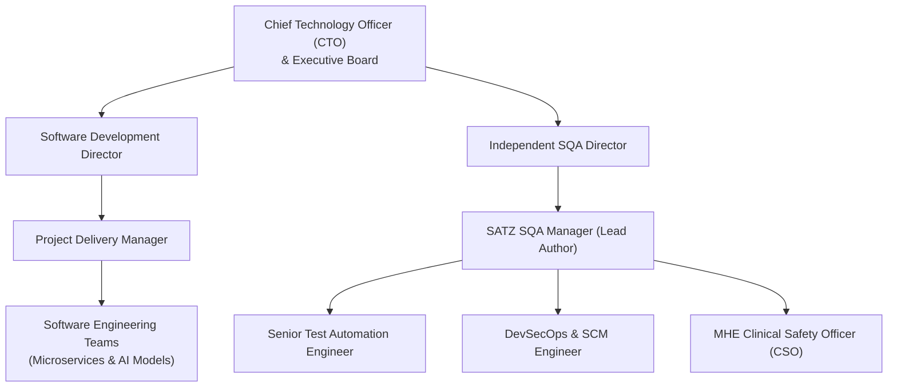

# 3.2 Tailored SQP: Management Roles, Responsibilities & QA Resources

> [!IMPORTANT]
> **Coursework Deliverable**: Part 3.2 Management-based SQP (10 Marks — Group).  
> **Standard Guidance**: **IEEE Std 730-2014** (Clause 5.2 SQA Management — Organization, Roles, Responsibilities & Resource Estimation).  
> **Core Objective**: Prevent project failure through rigorous organizational independence, clear accountability (RACI), and quantitative resource modeling (Cost of Quality).

---

## 🏛️ IEEE 730-2014 TAILORED SQP — SECTION 2: MANAGEMENT & RESOURCES

### 1.0 SQA Organization, Roles & Responsibilities (IEEE 730 Clause 5.2.1)

#### 1.1 Organizational Independence of SQA
A fundamental tenet of **IEEE Std 730-2014** is the **organizational independence** of Software Quality Assurance. In the SATZ corporate governance structure, the **SQA Manager reports directly to the Chief Technology Officer (CTO)**, maintaining complete operational autonomy from the Development Project Manager. This ensures quality engineers cannot be pressured to compromise test coverage, bypass security gates, or approve incomplete baselines to meet arbitrary delivery schedules.



#### 1.2 Dedicated SQA Role Profiles

| Role Title | Primary Mandate | Specific SQA Responsibilities (IEEE 730) |
| :--- | :--- | :--- |
| **SATZ SQA Manager** | Overall governance & plan execution | Approves SQP; chairs Change Control Board (CCB); conducts milestone quality audits; enforces IEEE 730-2014 compliance. |
| **Lead Systems Architect** | Architectural integrity & resilience | Governs microservice decoupling, ensures zero single points of failure (SPOF); validates disaster recovery runbooks. |
| **Senior Test Engineer** | Verification & Validation (V&V) | Designs automated integration, regression, and black-box test suites; manages test environments; executes load tests. |
| **DevSecOps & SCM Engineer** | Configuration integrity & CI/CD | Maintains Git branching controls; manages automated SAST/SCA security pipelines; oversees container image signing. |
| **MHE Clinical Safety Officer (CSO)**| Clinical governance & patient safety | Verifies algorithmic triage safety against NHS DCB0129 standards; conducts clinical hazard reviews; approves release. |
| **Compliance & Privacy Officer** | Statutory alignment & data rights | Verifies UK GDPR / Data Protection Act 2018 compliance; audits in-app privacy broker; conducts bi-annual DPIA audits. |

#### 1.3 RACI Governance Matrix for SQA Activities

| SQA Process Lifecycle Activity | SQA Manager | Lead Architect | Test Lead | DevSecOps / SCM | Clinical Safety Officer | Dev Team |
| :--- | :---: | :---: | :---: | :---: | :---: | :---: |
| **SQP Authoring & Tailoring (IEEE 730)** | **A / R** | C | C | C | C | I |
| **Baseline Creation & Audit (SCM)** | **A** | C | I | **R** | I | I |
| **Change Control Board (CCB) Approval** | **A** | C | C | C | C | I |
| **Peer Review Inspections (IEEE 1028)** | C | **A** | R | I | C | **R** |
| **Automated CI/CD Quality Gate Testing** | I | I | **A / R** | **R** | I | C |
| **Black Box & Usability Testing (Part 5)**| C | I | **A / R** | I | C | I |
| **Clinical Safety & Algorithmic Audit** | C | C | C | I | **A / R** | I |
| **Production Release Sign-off** | **A** | C | C | C | **A** | I |

*Key: **R** = Responsible (completes the work), **A** = Accountable (final decision/approver), **C** = Consulted (provides expertise), **I** = Informed (updated on outcome).*

---

### 2.0 Quality Assurance Estimated Resources (IEEE 730 Clause 5.2.2)

#### 2.1 Quantitative Staffing & Effort Estimation
To avoid repeating the catastrophic budget overshoot that bankrupted MHE's prior contractor, SATZ applies the **Constructive Cost Model II (COCOMO II)** and empirical SQA effort metrics (Pressman and Maxim, 2020). For safety-critical Level 7 healthcare software, SQA represents **28% of total engineering person-months (PM)**:

```
Total Project Development Effort:   75 Person-Months (PM)
Dedicated SQA Allocation (28%):    21 Person-Months (PM)

Breakdown of SQA Effort Allocation:
• SQA Planning & IEEE 730 Governance:          3.0 PM (14.3%)
• SCM, Build Pipelines & Automated DevSecOps:   4.5 PM (21.4%)
• Test Case Design, Execution & Automation:     8.5 PM (40.5%)
• Clinical Safety Validation & Hazard Audits:   3.0 PM (14.3%)
• Milestone Audits & Final Release Reviews:     2.0 PM (9.5%)
```

#### 2.2 Test Environments & Cloud Infrastructure
To guarantee high availability and validate failover mechanisms without risking live hospital operations, SATZ provisions three isolated cloud environments hosted on UK sovereign cloud regions:

1. **Dedicated Staging / SQA Cloud Environment (AWS/Azure UK South)**:
   - Mirrored Kubernetes cluster identical in topology to production.
   - Synthetic patient telemetry generator simulating **10,000 concurrent IoT sensor streams** and 500 simultaneous clinician sessions.
   - Automated Chaos Engineering harness (e.g., Chaos Mesh / Gremlin) to simulate node drops, network latency, and database failover.
2. **IoT Hardware-in-the-Loop (HIL) Test Laboratory**:
   - Physical rack deployed at Manchester Royal Infirmary containing actual hospital controllers, Modbus/BACnet edge gateways, and environmental sensors for physical signal validation.
3. **Disaster Recovery (DR) Simulation Sandbox (UK West)**:
   - Cold/Warm standby testbed used exclusively for bi-annual automated failover drills to verify RTO < 5 min and RPO < 1 min.

#### 2.3 SQA Tooling Stack & Estimated License Budget

| Tooling Category | Selected Software Platform | SQA Functional Purpose | Estimated Annual Resource Allocation |
| :--- | :--- | :--- | :--- |
| **Static Analysis & Security** | SonarQube Enterprise + Snyk | Automated code quality, technical debt tracking, and vulnerability scanning. | £12,500 |
| **Automated Test Harness** | Playwright + k6 Cloud + pytest | End-to-end UI automation, REST/gRPC API testing, and distributed stress testing. | £9,800 |
| **Configuration & CI/CD** | GitHub Enterprise + HashiCorp Vault | Immutable branch governance, secrets management, and cryptographic build signing. | £14,000 |
| **Telemetry & Observability** | Prometheus + Grafana + Datadog | APM monitoring, microservice latency tracing, and synthetic error logging. | £18,200 |
| **TOTAL TOOLING BUDGET** | — | — | **£54,500** |

#### 2.4 The Economic Business Case: Cost of Quality (CoQ) Model
To substantiate the SQA investment to MHE executives, SATZ articulates the project economics using the classic **Cost of Quality (CoQ)** framework:

```
                                  COST OF QUALITY (CoQ) MODEL
┌───────────────────────────────────────────────────┬───────────────────────────────────────────────────┐
│              COST OF CONFORMANCE (Good)           │            COST OF NON-CONFORMANCE (Bad)          │
├───────────────────────────────────────────────────┼───────────────────────────────────────────────────┤
│ 1. PREVENTION COSTS:                              │ 3. INTERNAL FAILURE COSTS:                        │
│ • SQA training & coding standards enforcement     │ • Rework of failing unit/integration tests        │
│ • Formal IEEE 1028 architecture inspections       │ • Defect re-testing and branch rebuilding         │
│ • Threat modeling and security design reviews     │ • Resolving merge conflicts prior to release      │
│                                                   │                                                   │
│ 2. APPRAISAL COSTS:                               │ 4. EXTERNAL FAILURE COSTS (The Contractor Trap!): │
│ • Automated CI/CD regression test suites          │ • Catastrophic clinical system downtime (£/min)   │
│ • Black box and boundary value testing            │ • Regulatory fines (UK GDPR Article 83 up to £17M)│
│ • Independent clinical safety verification audits │ • Clinical malpractice litigation & lost lives    │
│ • Disaster recovery failover simulation drills    │ • Total vendor collapse & reputational forfeiture │
└───────────────────────────────────────────────────┴───────────────────────────────────────────────────┘
```

- **Strategic Conclusion**: The collapsed predecessor firm attempted to eliminate Prevention and Appraisal costs, resulting in insurmountable Internal and External Failure costs that doomed the project. SATZ's heavy investment in Prevention (IEEE 730 planning) and Appraisal (automated CI testing) drastically suppresses total Cost of Quality, delivering reliable, sustainable healthcare software at reduced lifecycle expenditure.
