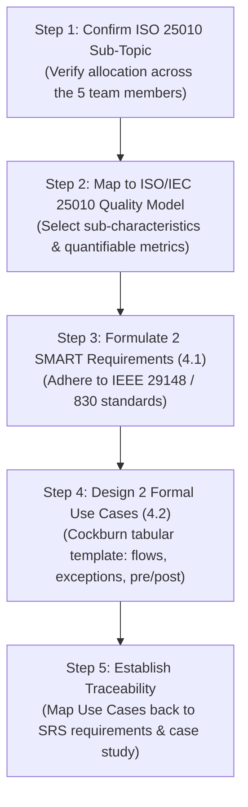

# Part 4: SRS & Use Cases (ISO/IEC 25010) — Step-by-Step Execution Guide

> [!IMPORTANT]
> **Part 4 Overview**: Individual Work (20% of Coursework Mark).  
> **Coursework Directive**: *"Each team member selects a sub-topic of the SRS: performance, security, portability, usability, and maintainability with the support of the ISO/IEC 25010 standard. You should individually write a brief document containing the description of two requirements as part of the SRS in your selected sub-topic. Furthermore, describe two use cases for your product based on the selected sub-topic."*  
> **Deliverables**:
> - **4.1 SRS (Software Requirements Specification)**: 2 SMART non-functional / architectural requirements based on ISO/IEC 25010 (10 marks — Individual).
> - **4.2 Use Cases**: 2 detailed formal use cases supporting the chosen sub-topic (10 marks — Individual).

---

## 🧭 Step-by-Step Execution Workflow

---

## 📋 Detailed Execution Instructions

### Step 1: Sub-Topic Deconfliction
Confirm your assigned sub-topic from the [[00 - Dashboard & Navigation/Group Coordination & Team Matrix|Team Matrix]]:
- **Member 1**: **Performance Efficiency** (Sub-characteristics: *Time behaviour*, *Resource utilisation*, *Capacity*)
- **Member 2**: **Security** (Sub-characteristics: *Confidentiality*, *Integrity*, *Non-repudiation*, *Authenticity*)
- **Member 3**: **Usability** (Sub-characteristics: *Learnability*, *Operability*, *User error protection*, *Accessibility*)
- **Member 4**: **Portability** (Sub-characteristics: *Adaptability*, *Installability*, *Replaceability*)
- **Member 5**: **Maintainability** (Sub-characteristics: *Modularity*, *Analyzability*, *Modifiability*, *Testability*)

### Step 2: Author Deliverable 4.1 (SRS - 2 Requirements)
- **Do NOT write vague statements** like *"The system must be fast"* or *"The system must be secure"*.
- For Level 7, every requirement must be **SMART** (Specific, Measurable, Achievable, Relevant, Traceable) following **ISO/IEC/IEEE 29148:2018**:
  - Unique Identifier (e.g., `SRS-SEC-01`, `SRS-PERF-01`).
  - Formal Requirement Statement using RFC 2119 keywords (`SHALL`, `MUST`).
  - Quantitative Verification Metric (e.g., *latency < 250ms at 99th percentile under 5,000 req/sec*).
  - Justification tied directly to the Manchester Healthcare Entity case study.
- Use the templates in [[05 - Part 4 - SRS & Use Cases (ISO IEC 25010) (Individual)/4.2 - SRS Specification Writing Guide & Requirements Templates|4.2 SRS Specification Guide]].

### Step 3: Author Deliverable 4.2 (2 Use Cases)
- A use case describes the behavioral interaction between external actors and the software system to achieve a specific goal.
- To secure the **80–100% Exceptional** mark band, use the **Cockburn Detailed Use Case Specification Template**:
  - Use Case ID & Descriptive Name.
  - Primary & Secondary Actors.
  - Triggering Event.
  - Preconditions & Postconditions (Minimal vs Success Guarantees).
  - Main Success Scenario (Numbered, sequential steps).
  - Extensions / Alternative Exceptional Flows (Error handling, timeouts, invalid data).
  - Non-Functional Mapping (Explicitly link each use case to the sub-topic requirement).
- Use the templates in [[05 - Part 4 - SRS & Use Cases (ISO IEC 25010) (Individual)/4.3 - Use Case Specification Guide & Detailed Templates|4.3 Use Case Specification Guide]].
