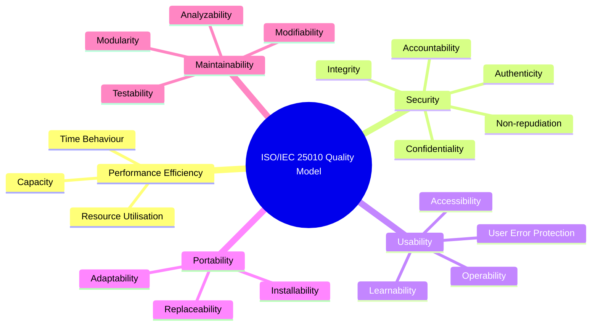

# 4.1 ISO/IEC 25010 Software Product Quality Model Deep Dive

> [!IMPORTANT]
> **Foundational Standard**: **ISO/IEC 25010:2011** (Systems and software engineering — Systems and software Quality Requirements and Evaluation - SQuaRE — System and software quality models).  
> **Coursework Sub-Topics**: The specification requires each student to select one of five sub-topics: **Performance**, **Security**, **Portability**, **Usability**, or **Maintainability**.

---

## 🏛️ The ISO/IEC 25010 Product Quality Model Architecture

---

## 🔍 In-Depth Breakdown of the 5 Coursework Sub-Topics

### 1. Performance Efficiency (Topic 1)
*Definition: The degree to which a system provides appropriate performance relative to the quantity of resources used under stated conditions.*

- **1.1 Time Behaviour**: Degree to which response and processing times and throughput rates of a product meet requirements when performing its functions.
  - *Healthcare Metric*: Triage inference response time under emergency load; p99 latency < 250ms for urgent bed reservation requests.
- **1.2 Resource Utilisation**: Amounts and types of resources used by a product when performing its functions (CPU, RAM, network bandwidth, battery).
  - *Healthcare Metric*: Mobile app CPU consumption < 5% during background telemetry tracking to preserve emergency battery life.
- **1.3 Capacity**: Maximum limits of a product parameter (concurrent users, transactions, throughput).
  - *Healthcare Metric*: Sustained ingestion capacity of 10,000 concurrent IoT sensor telemetry payloads per second with zero dropped frames.

---

### 2. Security (Topic 2)
*Definition: The degree to which a product protects information and data so that persons or systems have the degree of data access appropriate to their types and levels of authorization.*

- **2.1 Confidentiality**: Ensuring data is accessible only to those authorized to have access.
  - *Healthcare Metric*: End-to-end encryption (AES-256 GCM) for Electronic Patient Records (EPR); field-level tokenization for third-party logistics.
- **2.2 Integrity**: Preventing unauthorized modification of software programs or data.
  - *Healthcare Metric*: HMAC-SHA256 signature verification on all facility sensor telemetry to detect tampering or spoofed alert packets.
- **2.3 Non-Repudiation**: Proving actions or events have occurred so that they cannot be repudiated later.
  - *Healthcare Metric*: Cryptographic signing of emergency medicine administration orders and privacy opt-out requests.
- **2.4 Accountability**: Ensuring actions of an entity can be traced uniquely to the entity.
  - *Healthcare Metric*: Append-only, tamper-evident audit logging of all clinician record accesses, compliant with UK GDPR Article 30.
- **2.5 Authenticity**: Proving the identity of a subject or resource.
  - *Healthcare Metric*: Mandatory Multi-Factor Authentication (MFA) via NHS Login / FIDO2 tokens for all staff workstation sessions.

---

### 3. Usability (Topic 3)
*Definition: The degree to which a product can be used by specified users to achieve specified goals with effectiveness, efficiency, and satisfaction in a specified context of use.*

- **3.1 Learnability**: How easily users can achieve initial proficiency.
  - *Healthcare Metric*: Clinical staff able to execute triage dispatch within 5 minutes of first exposure without printed manual assistance (mitigating the training deficit).
- **3.2 Operability**: Degree to which attributes make the software easy to operate and control.
  - *Healthcare Metric*: Emergency triage decision pathway completed within ≤ 3 screen interactions (clicks/taps).
- **3.3 User Error Protection**: Protecting users against making errors and recovering smoothly.
  - *Healthcare Metric*: Real-time validation preventing physiological impossibilities (e.g., body temperature input > 45°C) with clear modal recovery warnings.
- **3.4 Accessibility**: Usable by people with the widest range of characteristics and capabilities.
  - *Healthcare Metric*: Conformance to **W3C WCAG 2.1 Level AA** standards across patient-facing portals (screen reader compatibility, minimum 4.5:1 color contrast).

---

### 4. Portability (Topic 4)
*Definition: The degree of effectiveness and efficiency with which a system, product or component can be transferred from one hardware, software or other operational or usage environment to another.*

- **4.1 Adaptability**: Adapting effectively to different specified hardware, software, or other operational environments.
  - *Healthcare Metric*: Native responsive rendering across diverse clinician hardware (hospital desktops, ambulance iPads, Android ruggedized field units).
- **4.2 Installability**: Installing or uninstalling effectively in a specified environment.
  - *Healthcare Metric*: Automated zero-downtime deployment of microservice containers using Helm charts on Kubernetes within < 3 minutes.
- **4.3 Replaceability**: Replacing another specified software product for the same purpose in the same environment.
  - *Healthcare Metric*: Seamless backward-compatible replacement of MHE's legacy booking database via HL7 FHIR API adapters.

---

### 5. Maintainability (Topic 5)
*Definition: The degree of effectiveness and efficiency with which a product can be modified by the intended maintainers.*

- **5.1 Modularity**: Composed of discrete components such that a change to one component has minimal impact on other components.
  - *Healthcare Metric*: Microservice boundaries isolated via API contracts; changes to the Reward Scheme Service cannot disrupt Triage dispatch.
- **5.2 Analyzability**: Assessing the impact of an intended change, diagnosing deficiencies or causes of failure.
  - *Healthcare Metric*: Distributed tracing via OpenTelemetry with correlation IDs, reducing Mean Time to Detection (MTTD) to < 60 seconds.
- **5.3 Modifiability**: Modifying without introducing defects or degrading existing product quality.
  - *Healthcare Metric*: Strict cyclomatic complexity < 10 per method; automated CI linting enforcing zero high-risk code smells.
- **5.4 Testability**: Establishing test criteria and performing tests to determine whether those criteria have been met.
  - *Healthcare Metric*: Automated unit test coverage maintained above 85% across all core domain repositories.
