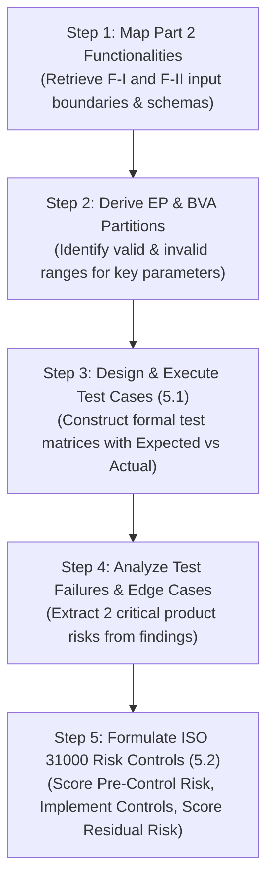

# Part 5: Black Box Testing & Risk Management — Step-by-Step Execution Guide

> [!IMPORTANT]
> **Part 5 Overview**: Individual Work (20% of Coursework Mark).  
> **Direct Coupling to Part 2**: You must test the exact **two functionalities** you defined in Part 2.1, and derive your risk management from those functionalities or testing results.  
> **Deliverables**:
> - **5.1 Black Box Testing**: Equivalence Partitioning (EP) & Boundary Value Analysis (BVA) test suites and execution results for Functionality I and II (10 marks — Individual).
> - **5.2 Product Risk Management**: 2 product risks evaluated via ISO 31000 / FMEA with concrete preventative/detective controls implemented (10 marks — Individual).

---

## 🧭 Step-by-Step Execution Workflow

---

## 📋 Detailed Execution Instructions

### Step 1: Input Domain Partitioning (For Deliverable 5.1)
1. Review the input fields of your two functionalities from [[03 - Part 2 - SQA & Architectural Blocks (Individual)/2.1 - Architectural Blocks & Data Structures Guide|Part 2.1]]:
   - *Example for Functionality 1 (Triage)*: Heart Rate (bpm), Systolic BP (mmHg), SpO2 (%), Ward Bed ID.
   - *Example for Functionality 2 (Predictive Maintenance)*: Operating Temperature (°C), Vibration RMS (mm/s), Pressure (bar).
2. For each field, establish:
   - **Equivalence Partitioning (EP)**:
     - 1 Valid Partition (e.g., Heart rate: 50 to 120 bpm).
     - At least 2 Invalid Partitions (e.g., Sub-physiological: < 20 bpm; Supra-physiological: > 260 bpm; Non-numeric / empty string).
   - **Boundary Value Analysis (BVA)**:
     - Test the exact boundary edges: Lower Boundary (`Min - 1`, `Min`, `Min + 1`) and Upper Boundary (`Max - 1`, `Max`, `Max + 1`).

### Step 2: Build the Test Execution Register (For Deliverable 5.1)
- Construct at least **3 to 4 comprehensive test cases per functionality** (total 6–8 test cases).
- Use the formal IEEE 829 test case specification format:
  - Test Case ID (e.g., `TC-BB-F1-01`).
  - Test Technique Applied (EP or BVA).
  - Preconditions.
  - Input Test Data.
  - Expected System Behaviour.
  - Actual Observed Behaviour.
  - Pass / Fail Status.
- Use [[06 - Part 5 - Black Box Testing & Risk Management (Individual)/5.2 - Test Case Design & Test Execution Report Template|5.2 Test Case Design Template]].

### Step 3: Identify 2 Potential Product Risks (For Deliverable 5.2)
- Specification directive: *"Please explain two (2) potential product risks from your functionalities or black box testing results from Section 5.1 above and implement appropriate controls for the risks."*
- Formulate two realistic risks:
  - **Risk 1** (derived from Functionality 1): E.g., *Sensor packet corruption or boundary clipping leads to incorrect triage score, delaying emergency treatment for an acute cardiac patient*.
  - **Risk 2** (derived from Functionality 2): E.g., *Vibration anomaly threshold alert drops during network congestion, resulting in undetected autoclave failure and surgical ward shutdown*.

### Step 4: Implement ISO 31000 Controls & Score Residual Risk (For Deliverable 5.2)
- Apply the **Likelihood (1–5) × Impact (1–5)** Risk Matrix:
  - Calculate **Initial Risk Score** (e.g., Likelihood 4 × Impact 5 = 20: Critical).
  - Define three tiers of **Implemented Controls**:
    1. *Preventative Control* (e.g., Schema validation & mTLS).
    2. *Detective Control* (e.g., Automated dead-letter queue watchdog).
    3. *Corrective Control* (e.g., Automated circuit breaker & clinician fail-safe fallback).
  - Re-evaluate **Residual Risk Score** post-control (e.g., Likelihood 1 × Impact 3 = 3: Low).
- Use [[06 - Part 5 - Black Box Testing & Risk Management (Individual)/5.4 - Risk Register & Control Implementation Template|5.4 Risk Register Template]].
