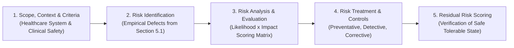

# 5.3 Risk Management Framework: ISO 31000 & FMEA Principles

> [!IMPORTANT]
> **Foundational Standard**: **ISO 31000:2018 (Risk Management — Guidelines)** & **IEC 60812 (Failure Mode and Effects Analysis - FMEA)**.  
> **Coursework Directive**: *"Please explain two (2) potential product risks from your functionalities or black box testing results from Section 5.1 above and implement appropriate controls for the risks."*

---

## 🧭 The ISO 31000 Risk Management Lifecycle



---

## 📊 The 5×5 Risk Assessment Matrix

In safety-critical clinical software, risk is quantitatively defined as:
$$\text{Risk Score} = \text{Likelihood} \times \text{Impact}$$

| Likelihood Rating (1 to 5) | Description & Frequency |
| :---: | :--- |
| **1: Rare** | Occurs only in exceptional edge cases (< 1 in 100,000 transactions). |
| **2: Unlikely** | Infrequent occurrence under unusual operational conditions. |
| **3: Possible** | Known to occur occasionally during peak clinical workloads. |
| **4: Likely** | High probability of occurrence during normal operating cycles. |
| **5: Almost Certain** | Predictable defect occurring repeatedly under standard conditions. |

| Impact Severity (1 to 5) | Clinical & Operational Consequence |
| :---: | :--- |
| **1: Negligible** | Cosmetic UI defect; zero impact on clinical care or system stability. |
| **2: Minor** | Minor operational delay; alternate manual workaround immediately available. |
| **3: Moderate** | Noticeable clinical delay; partial degradation of secondary service. |
| **4: Major** | Critical service outage; significant delay to emergency patient admissions. |
| **5: Catastrophic** | Fatal clinical outcome; patient death; complete regional healthcare paralysis; massive regulatory penalty. |

```
                       5x5 RISK EVALUATION MATRIX
          ┌─────────────────────────────────────────────────────────┐
          │  5 │ Low (5)   Med (10)  High (15)  Crit (20)  Crit (25)│
          │  4 │ Low (4)   Med (8)   Med (12)   High (16)  Crit (20)│
IMPACT    │  3 │ Low (3)   Low (6)   Med (9)    Med (12)   High (15)│
          │  2 │ Low (2)   Low (4)   Low (6)    Med (8)    Med (10) │
          │  1 │ Low (1)   Low (2)   Low (3)    Low (4)    Low (5)  │
          └────┴────────────────────────────────────────────────────┘
                  1          2         3          4          5
                                 LIKELIHOOD
```

---

## 🛡️ The Three Tiers of Risk Controls

To achieve the **80–100% Exceptional** mark band, you must not simply suggest a vague "fix". You must implement a structured, multi-layered control defense:

1. **Preventative Controls (Proactive)**:
   - Eliminates the root cause or blocks the hazardous condition before it occurs.
   - *Examples*: Strict input boundary validation, architectural circuit breakers, static schema checking, TLS cryptographic mutual authentication.
2. **Detective Controls (Real-Time Monitoring)**:
   - Detects and flags anomalous behavior or hazardous failure in real time.
   - *Examples*: Dead-letter queue alerts, automated telemetry watchdogs, Prometheus latency threshold triggers, memory leak monitors.
3. **Corrective Controls (Resilience & Recovery)**:
   - Restores the system to a safe operational state immediately upon failure.
   - *Examples*: Automatic failover to secondary cloud region, graceful degradation to safe default mode (e.g., reserving emergency bed without waiting for ML scoring), transaction rollback.
