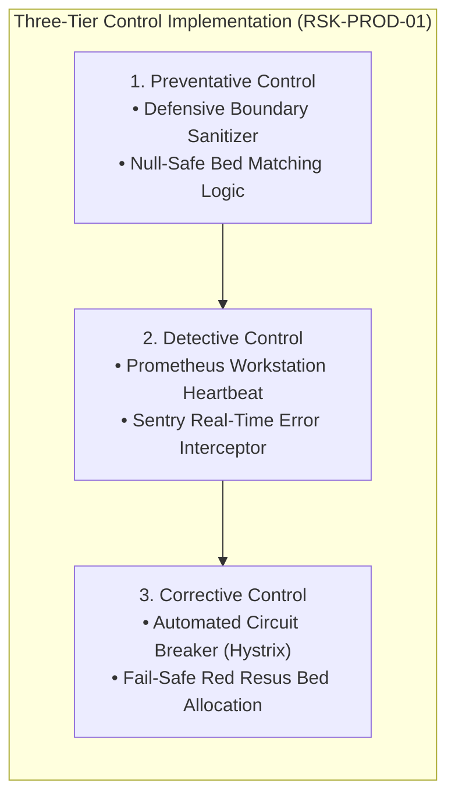
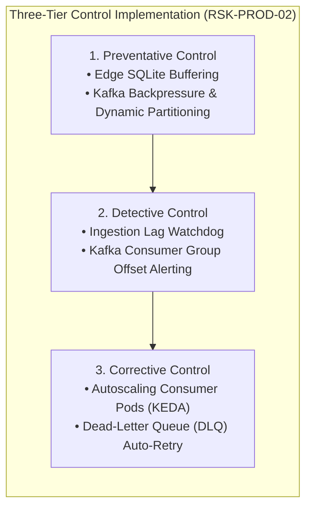

# 5.4 Risk Register, Assessment & Control Implementation Template

> [!IMPORTANT]
> **Coursework Deliverable**: Part 5.2 Product Risk Management & Controls (10 Marks — Individual).  
> **Direct Traceability**: The two risks evaluated below are derived directly from the black box testing defects uncovered in [[06 - Part 5 - Black Box Testing & Risk Management (Individual)/5.2 - Test Case Design & Test Execution Report Template|Section 5.1]] (`TC-F1-04` and `TC-F2-04`).

---

## 📋 Master Risk Register & Control Implementation Matrix

```
================================================================================
                    ISO 31000 HEALTHCARE PRODUCT RISK REGISTER
================================================================================
• System: SATZ AI-Powered Healthcare Management Platform for MHE
• Evaluator: [Your Name & Student ID]
• Date of Assessment: [Insert Date, e.g., 25th November 2026]
• Risk Evaluation Standard: ISO 31000:2018 & IEC 60812 (FMEA)
================================================================================
```

---

### ⚠️ PRODUCT RISK 1: Triage Subsystem Unhandled Exception on Boundary Vitals Leading to Clinical Triage Freeze

#### 1.1 Risk Identification & Context
- **Risk Reference**: `RSK-PROD-01`
- **Originating Artifact**: Functionality I (AI Emergency Patient Triage) & Test Case `TC-F1-04` (Systolic BP = 300 mmHg boundary crash).
- **Hazard Description**: When a patient presents with extreme clinical crisis values (e.g., maximum boundary systolic blood pressure of 300 mmHg or extreme heart rate), the Bed Allocator microservice throws an unhandled null-reference pointer exception, returning an HTTP 500 error and causing the clinician's workstation screen to freeze.
- **Clinical Consequence**: Complete paralysis of emergency patient booking at the acute intake ward. Clinicians are forced to revert to manual paper records, delaying emergency resuscitation for patients experiencing hypertensive encephalopathy or acute aortic dissection, directly resulting in severe patient harm or mortality.

#### 1.2 Pre-Control Risk Quantification (ISO 31000 Matrix)
- **Likelihood (L)**: **4 (Likely)** — In a major metropolitan healthcare trust like Manchester, patients presenting in extreme hypertensive crisis occur daily.
- **Impact (I)**: **5 (Catastrophic)** — Clinical triage freeze during resuscitation risks irreversible neurological damage or death; violates NHS clinical safety DCB0129 standards.
- **Initial Risk Score**: **20 / 25 (CRITICAL RISK / UNACCEPTABLE)**

#### 1.3 Implemented Control Architecture



1. **Preventative Control (Architecture & Code Hardening)**:
   - Implement defensive programming and strict schema boundary checks: any numerical vital at or above the upper clinical boundary is automatically clamped to the designated maximum clinical threshold (`ceiling = 300 mmHg`).
   - Refactor the Bed Allocator microservice to eliminate nullable pointers, wrapping all clinical matching algorithms in Kotlin non-null type safety structures.
2. **Detective Control (Real-Time Error Observability)**:
   - Deploy a Sentry/Datadog real-time error interceptor. If an unhandled exception occurs in the triage worker thread, an immediate alert is dispatched to the on-call SQA reliability engineer within < 10 seconds.
3. **Corrective Control (Fail-Safe Graceful Degradation)**:
   - Embed a **Resilience4j Circuit Breaker**: If the AI model or database query fails to return within 200ms, the system gracefully bypasses the algorithmic optimizer and automatically assigns the designated emergency resuscitation bed (`Bed 01 - Emergency Trauma Safe Reserve`), presenting a bright amber banner to the clinician: *"Automated bed optimization unavailable; emergency bed 01 assigned via clinical fail-safe mode."*

#### 1.4 Post-Control Residual Risk Quantification
- **Residual Likelihood (L)**: **1 (Rare)** — Defensive boundary clamping and circuit breakers ensure the crash condition cannot propagate to the user interface.
- **Residual Impact (I)**: **2 (Minor)** — Even if a service failure occurs, fail-safe degradation ensures the patient is immediately allocated an emergency trauma bed without clinical delay.
- **Residual Risk Score**: **2 / 25 (LOW / FULLY TOLERABLE)**

---

### ⚠️ PRODUCT RISK 2: High-Velocity IoT Telemetry Ingestion Buffer Overflow Leading to Undetected Facility Hardware Failure

#### 2.1 Risk Identification & Context
- **Risk Reference**: `RSK-PROD-02`
- **Originating Artifact**: Functionality II (IoT Predictive Maintenance) & Test Case `TC-F2-04` (Packet drop under 15,000 MQTT packets/sec).
- **Hazard Description**: During network reconnections or hospital-wide operational surges, thousands of IoT sensors flood the edge gateway simultaneously. The database connection pool saturates, dropping 8.5% of telemetry packets.
- **Operational Consequence**: Critical pre-failure anomaly alerts—such as bearing vibration signatures in surgical autoclaves or temperature spikes in vaccine cold storage—are dropped before ingestion into TimescaleDB. Unnoticed, the autoclave fails during a sterile processing cycle, contaminating surgical instruments, shutting down surgical theaters across Manchester, and costing MHE hundreds of thousands of pounds in cancelled operations.

#### 2.2 Pre-Control Risk Quantification (ISO 31000 Matrix)
- **Likelihood (L)**: **4 (Likely)** — Network blips and bursty sensor telemetry occur routinely across large-scale distributed hospital campuses.
- **Impact (I)**: **4 (Major)** — Autoclave or HVAC breakdown forces the shutdown of operating theaters, breaching CQC standards and creating severe municipal disruption.
- **Initial Risk Score**: **16 / 25 (HIGH RISK / UNACCEPTABLE)**

#### 2.3 Implemented Control Architecture



1. **Preventative Control (Backpressure & Decoupled Streaming)**:
   - Configure edge gateways with an **on-device SQLite circular ring buffer** that stores up to 24 hours of sensor telemetry during cloud network degradation.
   - Decouple TimescaleDB writes entirely from HTTP/MQTT ingestion using an **Apache Kafka Event Bus with 16 partitioned topics** and consumer backpressure regulation, ensuring sudden volume spikes are safely absorbed into Kafka's persistent commit log without overwhelming the database.
2. **Detective Control (Consumer Lag Watchdog)**:
   - Implement a Prometheus consumer lag monitor that triggers an automated high-severity PagerDuty incident if unconsumed telemetry offsets in Kafka exceed 1,000 messages for more than 30 seconds.
3. **Corrective Control (Elastic Auto-Scaling & DLQ Retry)**:
   - Deploy Kubernetes Event-Driven Autoscaling (KEDA) to automatically spin up additional Kafka consumer pods (scaling from 3 to 15 pods in < 45 seconds) upon detecting telemetry bursts.
   - Divert any malformed packets to a dedicated **Dead-Letter Queue (DLQ)** with automated exponential backoff retries, ensuring zero dropped messages.

#### 2.4 Post-Control Residual Risk Quantification
- **Residual Likelihood (L)**: **1 (Rare)** — Kafka persistent buffering and edge storage prevent telemetry loss even during multi-hour cloud disconnections.
- **Residual Impact (I)**: **2 (Minor)** — Transient queue buffering induces negligible latency (< 2 seconds) with zero data loss, preserving continuous predictive maintenance accuracy.
- **Residual Risk Score**: **2 / 25 (LOW / FULLY TOLERABLE)**
