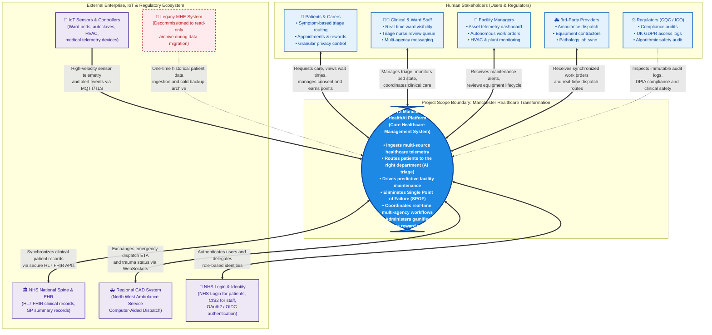

# Diagram 0: Core System Context Diagram (C4 Level 1 Conceptual Boundary)

> [!IMPORTANT]
> **Architectural Level**: **C4 Model — Level 1: System Context Diagram (Core System Boundary)**.  
> **Purpose**: This diagram precedes the High-Level System Architecture Diagram. It establishes the **strategic perimeter** of the SATZ AI-Powered Healthcare Management Platform, illustrating the core system, its operational boundaries, the five primary stakeholder groups, and external NHS/IoT systems.

---

## 🌐 Core System Context Diagram (Mermaid)

---

## 🏛️ Comprehensive Architectural Narrative (C4 Level 1 Rationale)

### 1.0 Why a Core System Context Diagram Precedes the Architecture Diagram
In software architecture engineering (Bass, Clements and Kazman, 2021; Brown, 2018), jumping straight into containers, microservices, and databases without first framing the **System Context** is an anti-pattern. 

The **Core System Context Diagram (C4 Level 1)** establishes the strategic boundaries of the project by explicitly declaring:
1. **What is INSIDE the Scope Boundary**: The *SATZ Manchester HealthAI Platform*—the unified, intelligent ecosystem commissioned to transform municipal healthcare.
2. **What is OUTSIDE the Scope Boundary**: Existing hospital hardware, national NHS backbones, external ambulance dispatchers, and legacy databases that SATZ must interoperate with but does not rebuild from scratch.
3. **The Human Actors**: The diverse human personas who interact with the system, highlighting their distinct clinical, operational, and regulatory needs.

---

### 2.0 Key Entities & Relational Breakdown

| Category | Entity Name | Nature of Interaction with the Core System |
| :--- | :--- | :--- |
| **Core System** | **SATZ Manchester HealthAI Platform** | The centralized cognitive management software responsible for AI triage, predictive facility maintenance, real-time collaboration, and high-availability operations. |
| **Human Actor** | **Patients & Carers** | Accesses care via mobile/web portals, manages granular privacy settings under UK GDPR, checks real-time appointment availability, and earns wellness rewards. |
| **Human Actor** | **Clinical & Ward Staff** | Gains real-time operational visibility into bed occupancy, reviews triage cases escalated by the AI, and coordinates multi-party patient handovers. |
| **Human Actor** | **Facility Managers** | Monitors real-time environmental status, HVAC stability, and autoclave pressures; receives automated work orders before equipment fails physically. |
| **Human Actor** | **3rd-Party Providers** | Private ambulance contractors, outsourced medical equipment technicians, and diagnostic laboratories receiving synchronized dispatch and inventory updates. |
| **Human Actor** | **Regulators (CQC / ICO)** | Audits immutable access logs, verifies algorithmic fairness, and monitors compliance with the Data Protection Act 2018. |
| **External System** | **IoT Sensors & Controllers** | Hardware sensors streaming high-frequency telemetry (pressure, vibration, temperature, vitals) and edge controllers. |
| **External System** | **NHS National Spine & EHR** | The statutory UK healthcare backbone providing electronic health records via standardized HL7 FHIR APIs. |
| **External System** | **Regional Ambulance CAD** | North West Ambulance Service Computer-Aided Dispatch synchronizing real-time emergency transport and arrival ETAs. |
| **External System** | **NHS Login & Identity Provider** | UK identity services: NHS Login for patients and NHS CIS2 for staff authentication. |
| **External System** | **Legacy MHE System** | The fragile, monolithic legacy application being phased out. Relegated to a read-only historical archive, permanently eliminating the Single Point of Failure (SPOF). |

---

## 💡 How to Position This Diagram in Your Coursework (Part 1.1)

In your **Project Description Document (Section 1.1)**, structure your diagrams logically:
1. **First: [Diagram 0 - Core System Context Diagram](file:///P:/PersonalFiles/Academic/Greenwich/Academic/COMP1833-SQM/07%20-%20Diagrams%20&%20Visual%20Models/Diagram%200%20-%20Core%20System%20Context%20Diagram.md)**  
   *Caption: "Figure 1: Core System Context Diagram (C4 Level 1) of the SATZ Manchester HealthAI Platform, illustrating system perimeter, stakeholder interactions, and external integrations."*  
   *Purpose: Introduces the high-level boundary, external actors, and NHS integrations.*
2. **Second: [Diagram 1 - Healthcare System Architecture](file:///P:/PersonalFiles/Academic/Greenwich/Academic/COMP1833-SQM/07%20-%20Diagrams%20&%20Visual%20Models/Diagram%201%20-%20Healthcare%20System%20Architecture.md)**  
   *Caption: "Figure 2: High-Level System Architecture (C4 Level 2) illustrating multi-tier containerization, microservice decoupling, Kafka streaming, and geo-replicated disaster recovery."*  
   *Purpose: Zooms inside the core system box to show microservices, databases, and failover.*
3. **Third: [Diagram 2 - Software & Operational Flow](file:///P:/PersonalFiles/Academic/Greenwich/Academic/COMP1833-SQM/07%20-%20Diagrams%20&%20Visual%20Models/Diagram%202%20-%20Software%20&%20Operational%20Flow.md)**  
   *Caption: "Figure 3: Software & Operational Process Flow Diagram illustrating end-to-end data ingestion, AI triage, automated dispatch, and reward distribution."*  
   *Purpose: Demonstrates the dynamic temporal execution and data flows across the system.*
