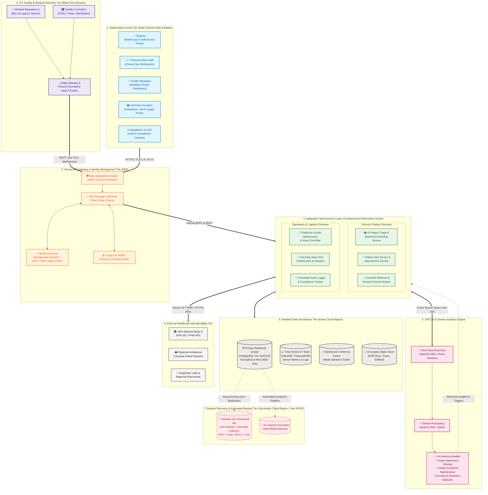

# Diagram 1: AI-Powered Healthcare System Architecture (C4 Model & High Availability)

> [!IMPORTANT]
> **Coursework Deliverable**: Part 1.1 Project Description Document (10 Marks).  
> **Requirement**: *"Please introduce a diagram to support your project description."*  
> This diagram represents the **Target Enterprise Architecture** for SATZ's transformation of Manchester Healthcare Entity (MHE). It directly addresses all clinical bottlenecks, IoT integration, AI analytics, and specifically **eliminates the legacy Single Point of Failure (SPOF)**.

---

## 📐 High-Level Architecture Diagram (Mermaid)

---

## 🏛️ Comprehensive Architectural Breakdown (Level 7 Academic Narrative)

### 1. Architectural Style & Design Justification
The SATZ Healthcare Platform transitions Manchester Healthcare Entity (MHE) away from an antiquated, monolithic architecture prone to catastrophic failure toward a **Decoupled, Event-Driven Microservices Architecture** deployed on a **Primary / Hot-Standby Cloud Foundation with Automated Geo-Redundancy**:
- **Fault Isolation**: Individual microservices (e.g., *Reward Scheme Service*) cannot crash core life-critical services (e.g., *Predictive Triage Service*).
- **Elimination of Single Point of Failure (SPOF)**: Addressing MHE's primary operational risk. By pairing an Active Primary Relational Cluster with an Asynchronously Geo-Replicated Hot Standby (Secondary Region), the architecture achieves a **Recovery Time Objective (RTO) < 5 minutes** and **Recovery Point Objective (RPO) < 1 minute**.
- **Elastic Scalability**: Healthcare demand spikes (e.g., winter flu epidemics or localized emergencies) are handled dynamically via Kubernetes Horizontal Pod Autoscalers (HPA).

### 2. Tier-by-Tier Component Specifications

| Tier | Key Components | Technical Implementation & Rationale |
| :--- | :--- | :--- |
| **1. Stakeholder Access Tier** | Responsive Web App, iOS/Android Mobile App, Clinical Tablet UI, Contractor Portal. | Built using TypeScript/React and React Native. Ensures **accessibility (WCAG 2.1 AA)** and multi-device usability across patients, ward staff, and external drivers. |
| **2. IoT & Facility Telemetry Tier** | Ward Bed Sensors, Environmental Thermostats, Power Controllers, Edge Gateways. | Ingests real-time telemetry via **MQTT over TLS 1.3**. Edge gateways perform protocol normalization and local caching in case of temporary network disruption. |
| **3. Security & API Gateway Tier** | Web Application Firewall (WAF), Kong API Gateway, OAuth2 / OIDC Identity Broker. | Centralizes authentication, rate limiting, and mTLS. Integrates with **NHS Login** (patients) and **NHS CIS2** (staff), and enforces the **UK Data Protection Act 2018 / UK GDPR** via dedicated In-App Privacy & Consent Brokers. |
| **4. Application Microservices Tier** | AI Triage & Routing, Patient Self-Service, Gamified Reward Engine, Facility Controller, Collaboration Service, Audit Logger. | Decoupled Spring Boot / Go microservices packaged in OCI-compliant Docker containers managed via Kubernetes. Enables independent updates, testing, and continuous deployment without hospital-wide downtime. |
| **5. AI & Stream Analytics Engine** | Apache Kafka, Apache Flink, Python ML Inference Services (PyTorch/Scikit-Learn). | Ingests event streams in real time. Runs the triage classifier and predictive maintenance algorithms to anticipate autoclave, HVAC, or scanner failures *before* they disrupt clinical workflows. |
| **6. Data Persistence Tier** | PostgreSQL High-Availability Cluster, TimescaleDB, Redis Cluster, Encrypted Object Storage. | Segregates operational relational data, high-velocity time-series sensor telemetry, and cached session data. Encrypted at rest using **AES-256** with HSM-managed keys. |
| **7. Disaster Recovery & Backup Tier** | Hot Standby Geo-Replica, Air-Gapped Immutable Snapshots. | Direct countermeasure to MHE's legacy SPOF vulnerability. Features automated health checks and DNS failover (Route 53 / Cloudflare). |
| **8. External Interoperability Tier** | NHS National Spine, Ambulance CAD, Regional Pharmacies. | Adheres to **HL7 FHIR (Fast Healthcare Interoperability Resources)** standards, guaranteeing compliant data exchange across external healthcare providers. |

---

## 💡 How to Use This Diagram in Your Coursework Report (Part 1.1)

1. **Figure Caption**: Label the diagram formally as `Figure 1: Target System Architecture of the SATZ AI-Powered Healthcare Management Platform for MHE`.
2. **Critical Commentary**: Emphasize how this architecture directly solves the three major historical weaknesses identified in the case study:
   - *Past Project Collapse*: Modular microservices ensure that if one component needs replacement, the entire platform does not fail.
   - *Single Point of Failure*: Highlight the split between Tier 6 (Primary Data) and Tier 7 (Geo-Replication & Automated Failover).
   - *Disjointed Communication*: Highlight Tier 4's *Provider Collaboration Service* coupled with Tier 5's *Kafka Event Bus*, enabling real-time multi-agency notifications.
