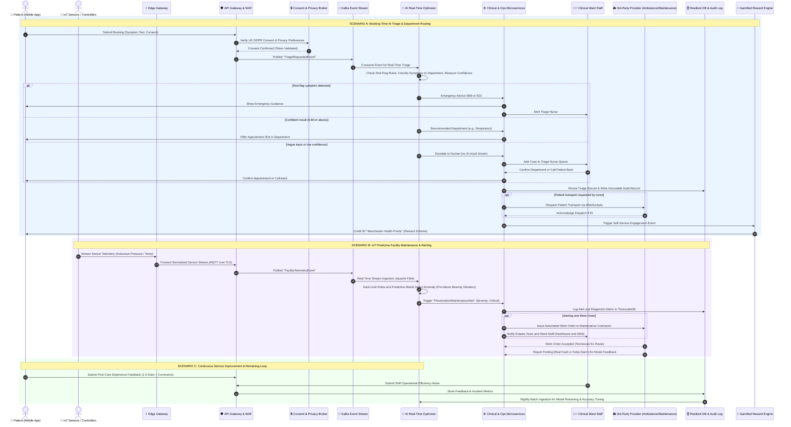

# Diagram 2: Software & Operational Process Flow (End-to-End Ingestion, AI & Dispatch)

> [!IMPORTANT]
> **Coursework Deliverable**: Part 1.1 Project Description Document (10 Marks).  
> This diagram illustrates the **Dynamic Operational Flow** of data, decision-making, and multi-agency coordination through the SATZ platform. It traces two complementary lifecycles:  
> 1. **Patient-Initiated Care & Self-Service Flow** (Booking -> Privacy Check -> AI Triage -> Department Routing or Nurse Review -> Reward Allocation).  
> 2. **IoT-Initiated Facility Predictive Maintenance Flow** (Sensor Telemetry -> Edge Gateway -> Rules & AI Anomaly Detection -> Alert & Automated Work Order -> Third-Party Contractor Dispatch).

---

## 🔄 End-to-End Software Flow Diagram (Mermaid)

---

## 📊 Detailed Narrative of Operational Stages (Level 7 Quality)

### Stage 1: Multi-Source Telemetry Ingestion & Privacy Verification
The operational flow begins at the edge. Patient interactions initiate via high-accessibility web or mobile endpoints, while physical facility assets stream telemetry at sub-second intervals:
- **UK GDPR Enforcement**: In compliance with the UK Data Protection Act 2018, every incoming transaction passes through the **In-App Privacy & Consent Broker**. If a patient has revoked consent for non-essential telemetry tracking, the system automatically sanitizes and anonymizes the payload prior to event publishing.
- **Protocol Normalization**: The Edge Gateway buffers and normalizes raw industrial sensor data (e.g., Modbus, BACnet, CoAP) into structured JSON payloads over **MQTT TLS 1.3**, preventing packet loss during local network instability.

### Stage 2: Event-Driven Decoupling via Apache Kafka
Rather than coupling the user interface directly to processing databases, incoming requests are published as strongly-typed events to an **Apache Kafka Event Bus**:
- **Benefits**: Decouples traffic spikes from backend processors, provides durable message buffering, and enables concurrent, asynchronous consumers (e.g., Clinical microservices, audit logger, analytics engine).

### Stage 3: AI Inference & Real-Time Operational Decisioning
The SATZ AI Engine operates concurrently on event streams:
- **AI Triage Routing**: Deterministic red-flag rules and a text classifier recommend a department from the symptoms the patient types at booking. The AI **never diagnoses**. If it is not confident, or the input is vague, the case is passed to a triage nurse, and any AI failure falls back to the nurse (fail-safe).
- **Predictive Facility Maintenance**: Fixed hard-limit rules always alert on unsafe readings, and time-series anomaly detection (e.g., Isolation Forests / LSTM autoencoders) detects vibrational or thermal drift in critical infrastructure (autoclaves, generators, ventilation) before hardware failure occurs. The platform raises alerts and work orders, and does not automatically shut down equipment.

### Stage 4: Synchronized Multi-Agency Dispatch & Collaboration
Addressing the case study's finding that *"there is no real-time collaboration among service providers"*:
- When an emergency or maintenance event is triggered, the **Application Microservices Layer** broadcasts bidirectional notifications simultaneously to ward workstations, mobile clinical devices, and third-party contractors (e.g., ambulance dispatchers, outsourced biomedical engineers) using secure **WebSockets**.
- Both parties acknowledge receipt, synchronizing status in real-time on a single shared operational dashboard.

### Stage 5: Gamified Adoption & Continuous Improvement Loop
Addressing MHE's mandate to encourage digital self-service and drive ongoing enhancements:
- **Reward Scheme Engine**: Successfully completed self-service actions (e.g., digital triage pre-checkin, attending preventive health screenings, completing follow-ups) trigger automated credit of "Health Points", redeemable for wellness subsidies or municipal benefits.
- **Continuous Feedback**: Post-service feedback from clinicians and patients is logged into the audit repository and ingested during automated retraining cycles, ensuring algorithms continuously adapt to Manchester's shifting clinical realities.

---

## 💡 How to Integrate Diagram 2 into Your Coursework Report

- **Pairing with Diagram 1**: While Diagram 1 provides the structural *spatial blueprint* (where components reside), Diagram 2 provides the *temporal dynamic narrative* (how data and events actually flow).
- **Referencing in Section 1.1**: Cite this diagram to demonstrate how the platform achieves real-time collaboration and eliminates the informational silos that crippled MHE's prior implementation.
